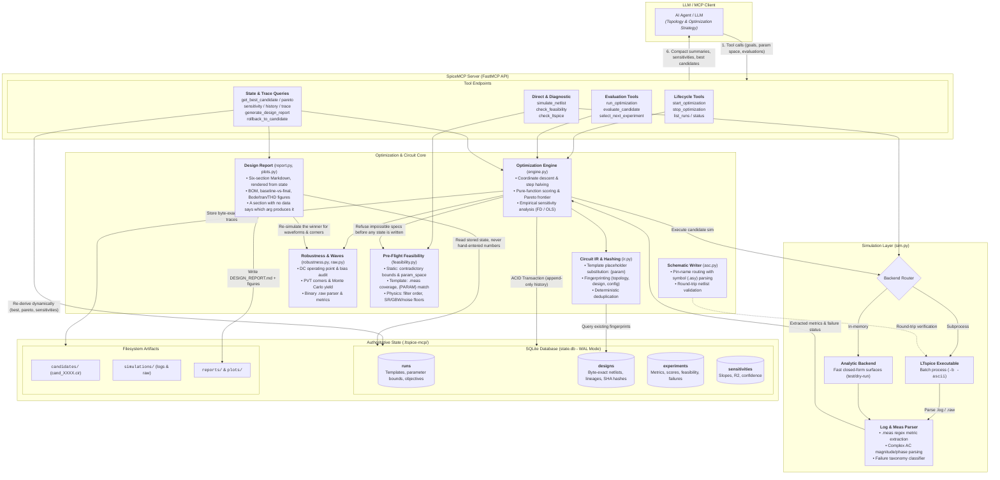

# SpiceMCP

LTspice MCP server where **the server owns the optimization state, not the LLM**.

The model contributes topology and strategy. Candidate identity, simulation history,
dedup, best-so-far, sensitivities and rollback all live in SQLite and are re-derived
on every call, so a long optimization can't drift into remembering a circuit that
never existed.

## Architecture



## Install

```bash
pip install -e ".[dev]"
pytest -q                                
```

LTspice is auto-detected (`AppData\Local\Programs\ADI\LTspice\LTspice.exe`,
`Program Files\LTC\LTspiceXVII\XVIIx64.exe`, …). Override with `LTSPICE_EXE`.

Register with your MCP client:

```json
{
  "mcpServers": {
    "spicemcp": {
      "command": "python",
      "args": ["-m", "spicemcp.server"],
      "env": { "SPICEMCP_PROJECT": "C:/path/to/your/circuit/project" }
    }
  }
}
```

State lands in `$SPICEMCP_PROJECT/.ltspice-mcp/`:

```
state.db      authoritative state
candidates/   cand_XXXX.cir, byte-exact netlists for rollback
simulations/  LTspice working dirs and logs
cache/  reports/
```

## Metrics come from `.meas`

There is no `.raw` waveform parser. Every metric you want to optimize is a `.meas`
directive in the netlist, and the server reads the values back from LTspice's `.log`.
The metric definitions then live with the circuit, versioned alongside it.

```spice
.ac dec 100 1 10Meg
.meas AC gain_db MAX mag(V(out))          ; mag(), NOT db() -- see below
.meas AC bandwidth WHEN mag(V(out))=0.707 FALL=1
.meas TRAN power AVG (-I(V1)*V(vcc))
```

**Never wrap an AC `.meas` in `db()`.** LTspice already reports AC measurement
magnitudes in dB, so `db()` converts twice — and it never errors, it just returns a
smaller plausible number. Verified on 26.0.2: a gain of 100 measures as `40dB` via
`mag()` but `32.04dB` (= 20·log10(40)) via `db()`. The server lints for this and
returns a warning alongside the metrics.

AC results are complex, so the phase is available too, as `<name>_deg`:

```
gdb: MAX(mag(V(out)))=(40.0dB,-159.417738334°)   ->  gdb = 40.0, gdb_deg = -159.42
```

One more trap, because two `.meas` forms print the same shape with opposite meanings:

```
bw:   mag(V(out))=0.7071  AT 159158.003411       -> 159158  (WHEN: the crossing)
p050: V(out) =0.140915020014 at 6.666666667e-05  -> 0.1409  (FIND AT: the value)
```

In a `WHEN` measure the number after `=` is the trigger level *you wrote* and `AT`
carries the result; in `FIND ... AT` it is the reverse. LTspice separates them only by
case — uppercase `AT` for a point it found, lowercase `at` for one you specified — so
the parser is case-sensitive here. Getting it backwards returns the sample time as the
measurement, which plots as a perfectly plausible straight line.

## Pre-flight: is the spec even possible?

`check_feasibility` answers that before a single LTspice process starts. It costs no
simulation and no tokens beyond the call, and it exists because the expensive failure
mode is an optimization loop that runs 40 iterations against a requirement no topology
can meet, then reports a confident near-miss.

```python
check_feasibility(
  objectives=[{"metric": "slew_rate", "direction": "max"}],
  constraints={"slew_rate": ">1e8", "power": "<0.0005"},
  circuit_type="opamp", mode="concept",
  technology_params={"vdd": 1.8, "cload": 10e-12})

# status: "infeasible", passed: false
# power_below_dynamic_floor: power < 0.0005 W, but the slew requirement alone draws
#   0.001 A from 1.8 V = 0.0018 W, before bias, output stage or reference current
# suggestion: raise the power limit above 0.0018 W, drop C_load, or relax the slew
#   requirement
# details: theoretical_min_power = 0.0018, power_floor_from = "slew"
```

Three layers, each reported separately so you can tell a typo from physics:

| layer | catches |
|---|---|
| `static` | contradictory bounds (`fc > 10k` and `fc < 9k`), over-unity efficiency, inverted or empty `param_space`, `P_max < Vdd·I_load` |
| `template` | an objective or constraint with no `.meas` that produces it, `{PARAM}` vs `param_space` mismatches in both directions, gain > 1 demanded of an R-and-C-only deck, reactive-element count vs the filter order the mask needs |
| `physics` | closed-form limits per `circuit_type` — filter order (Butterworth / Chebyshev / elliptic), `SR ≤ I/C_L`, `GBW ≤ gm/2πC_L` against both the bias current and `f_T`, `4kTR` and `kT/C` noise floors, LDO dropout / headroom / the `Vout/Vin` efficiency ceiling, boost-without-an-inductor, duty cycle |

`mode` picks how strict: `practical` (physics plus engineering guidelines — R > 100 MΩ,
C < 0.1 fF, phase margin under 45°, W/L over 1000), `theoretical` (hard limits only),
`concept` (no netlist needed, for checking an idea before writing a deck).

`status` is one of four, and the fourth is the point:

- **`infeasible`** — a hard bound is violated. `passed` is false. Every error here is a
  bound that holds for *any* topology, derived from a definition or a conservation law,
  so the answer is to change the spec.
- **`impractical`** — buildable, with flagged concerns. `passed` is true.
- **`feasible`** — nothing ruled it out and every applicable check ran.
- **`unverified`** — nothing ruled it out but a check that mattered could not run,
  usually a missing `technology_params` entry. It outranks `impractical`, because a
  warning is visible in `violations` either way while a silently skipped physics check
  reads as a pass. What was skipped is listed in `checks_skipped`.

`start_optimization` runs the same check first and **does not create the run** when a
requirement is impossible — the answer carries the violations and suggested fixes
instead, and no state is written. Warnings ride along and block nothing.

```python
start_optimization(..., preflight={"bypass": True})     # skip the check entirely
start_optimization(..., preflight={"circuit_type": "ldo", "mode": "theoretical",
                                   "technology_params": {"vin": 5.0, "vout": 1.8}})
```

The check is skipped for `backend: "analytic"`: those metrics come from a registered
Python function, so `.meas` directives and `{PARAM}` placeholders mean nothing there and
every template check would be a false positive.

## Usage

`start_optimization` once, then let `run_optimization` do the iterating:

```python
start_optimization(
  run_id="amp_001",
  netlist_template=open("amp.cir").read(),   # tunables written as {R1}, {C1}
  param_space={"R1": {"min": 1e3, "max": 100e3},
               "C1": {"values": [1e-9, 4.7e-9, 1e-8]}},
  objectives=[{"metric": "gain_db",   "direction": "max"},
              {"metric": "bandwidth", "direction": "max"},
              {"metric": "power",     "direction": "min"}],
  constraints={"bandwidth": ">100000", "power": "<0.005"},
  seed=42)

run_optimization(run_id="amp_001", iterations=40)   # 40 sims, ONE compact answer
```

A two-sided bound needs the list form, since a dict can't hold two entries for one
metric: `constraints=[{"metric": "fc", "op": ">", "value": 9500},
{"metric": "fc", "op": "<", "value": 10500}]`.

`run_optimization` returns a summary, not a transcript: best candidate, constraint
status, the strongest measured sensitivity, the most promising unexplored region,
`step_frac_final` (how far the step had to shrink), and `at_param_space_bound` — which
parameters sit on a `min`/`max`/list edge. That last one matters: a bounded search
always reports *an* optimum, and if the winner is pinned to the fence you drew, the
answer is "widen `param_space`", not "converged".

The full history stays queryable but never arrives unasked.

## Schematics from LTspice's own parts

`spicemcp.asc` writes a real `.asc` using LTspice's symbol library, so a candidate opens
as a schematic you can probe and edit — not as a netlist in a text window. Pin offsets
are read from the actual `.asy`, which means `res`, `cap`, `OpAmps/opamp`, `nmos`, `npn`
and everything else in `lib/sym` work with no per-part table.

Wire by **pin name**; nothing takes a pin coordinate:

```python
from spicemcp import asc
sh = asc.Sheet()
V1 = sh.part("voltage", "V1", (0, 80), value="AC 1")
R1 = sh.part("res", "R1", (80, 112), "R270", value=1849.60938)
U1 = sh.part("OpAmps/opamp", "U1", (480, 176), "M180",
             SpiceLine="Aol=1Meg", SpiceLine2="GBW=1G")
sh.net(V1["+"], R1["A"])
sh.route(R1["B"], U1["noninvin"], "VH")     # L-shaped, no intermediate points
sh.gnd(V1["-"]);  sh.flag(U1["out"], "out")
sh.directive(".lib opamp.sub", ".ac dec 400 100 1Meg")
assert "XU1 out b out opamp" in asc.check(sh.write("f.asc"))
```

`check()` netlists the drawing back through LTspice and returns its element lines. Use
it — it is the only way to know the picture is the circuit you meant. A wrong
orientation or an unwired pin produces a schematic that opens and simulates happily,
and comparing against the candidate netlist is what catches it. Directives and notes
auto-stack above and below the drawn content, so text placement isn't a coordinate
either.

Use the library part, not an equivalent model: `E1 out 0 in out 1e6` is a VCVS, and
`OpAmps/opamp` is a single-pole amplifier with `Aol` and `GBW` you can dial. `GBW` is a
real knob, not a formality — on a 10 kHz Sallen-Key, going from an effectively ideal
`GBW=1G` to the block's own `GBW=10Meg` default moves the corner 1.55 Hz and the step
overshoot from 5.76 % to 5.81 %.

## The final design report

`generate_design_report` writes the whole thing — six sections of Markdown, every number
read out of `state.db` or out of a simulation launched while writing the file. Nothing is
hand-entered, so the report cannot disagree with the run it describes.

```bash
python -m spicemcp.report amp_001 --dc-audit --pvt --supply V1 --mc 100
# .ltspice-mcp/reports/amp_001_DESIGN_REPORT.md
```

```python
generate_design_report(run_id="amp_001", dc_audit=True, pvt=True,
                       supply="V1", monte_carlo=100, schematic="pics/amp.png")
```

| section | contents |
|---|---|
| 1 · Executive summary | topology and what the run does and does not establish, constraint scorecard |
| 2 · Schematic & BOM | designators, optimized values in engineering units (`81.4 kΩ`, `12.2 nF`), which knob tuned each one, tolerance, `.model` cards, link to the byte-exact `.cir` |
| 3 · Optimization & verification | `Metric │ Target │ Baseline │ Final │ Δ │ Status`, measured sensitivities with their method, trade-offs, bound warnings |
| 4 · Waveform analysis | Bode (gain, phase, −3 dB, PM/GM), transient (rise, overshoot, ±1 % and ±0.1 % settling, slew), FFT/THD, with plots |
| 5 · Robustness | per-device Vds/Vgs/Vth/current/region, PVT corners, Monte Carlo yield and Cpk |
| 6 · Reproduction guide | open the `.cir`, the directives already in it, F9, Ctrl+L |

Sections 1–3 and 6 are free — they are a query. The rest each cost LTspice launches, so
they are opt-in: one shared re-run of the winner (it draws the plots *and* reports whether
the fresh metrics still match the stored ones), plus `dc_audit` 1, `pvt` 5, `monte_carlo`
one stepped run rather than N.

**A section that did not run says so, and says which argument would produce it.** That is
the whole design constraint. A reviewer reads a missing heading as "checked, nothing to
report", so an unswept corner analysis prints as `> **Not run.** … To include it:
generate(con, run_id, pvt=True)` rather than being quietly dropped or filled with zeros —
the same reason `check_feasibility` reports `checks_skipped` at the other end of the
pipeline. Two more places it refuses to fill a gap:

- Monte Carlo **yield** is counted against the run's own constraints. With no interval for
  a metric, the table is labelled a spread and `pass` is called what it is: nothing checked.
- No schematic is drawn. A netlist has no coordinates, and an invented layout is a picture
  of a different circuit — pass `schematic=` an image you drew with `spicemcp.asc` and
  round-tripped through `asc.check()`.

### Tools

| lifecycle | evaluation | state queries |
|---|---|---|
| `start_optimization` | `evaluate_candidate` | `get_best_candidate` |
| `stop_optimization` | `run_optimization` | `get_pareto_frontier` |
| `get_optimization_status` | `select_next_experiment` | `get_optimization_history` |
| `list_runs` | `simulate_netlist` | `get_candidate` / `get_previous_candidates` |
| | `check_ltspice` | `compare_candidates` / `get_similar_candidates` |
| | `check_feasibility` | `get_parameter_sensitivity` |
| | | `get_explored_parameter_range` |
| | | `get_failed_candidates` |
| | | `get_optimization_trace` |
| | | `generate_design_report` |
| | | `rollback_to_candidate` |

## Guarantees worth knowing

- **A worse iteration cannot demote the incumbent.** `best_candidate` is a `MAX(score)`
  query, and `score` is a pure function of a candidate's metrics (per-objective `ref`
  scales fixed at run creation). Nothing to overwrite, so nothing can be overwritten.
- **Modification never mutates.** A changed parameter set is a new `cand_NNNN` with a
  `parent_id`; the tree reconstructs exactly how any candidate was produced.
- **Duplicates aren't re-simulated.** Lookup by `sha256(design) + sha256(sim_config)`.
  Same circuit under different conditions is a *different experiment*, not a duplicate.
- **`rollback_to_candidate` restores stored bytes**, never a reconstruction.
- **Sensitivities are measured.** `finite_difference` means it came from candidate pairs
  differing in that parameter alone; `ols_marginal` is a weaker correlational fit, and
  the method is reported so you can tell them apart.
- **Every parameter gets screened once.** A parameter nobody has varied has no measured
  sensitivity, so no amount of exploiting can pick it — the search would fixate on
  whichever knob the seed happened to move. Unmeasured therefore outranks unexploited,
  and a decade-spaced `values` list steps to the adjacent entry rather than by a
  fraction of its span (±15% of `1e-8` snaps back to `1e-8`, which would freeze every
  E-series part you list).
- **The search is scale-free, cycles coordinates, and refines its step.** Three ways a
  bounded local search reports a confident near-miss instead of an answer, all three
  found by running a real filter to completion:
  - ranking parameters by raw `d(metric)/d(param)` compares farads against ohms, so the
    capacitor always wins — leverage is scaled by each parameter's range instead;
  - greedy coordinate descent never revisits a lower-ranked coordinate while a
    higher-ranked one still has untried values, and a continuous one always does, so
    coordinates take turns;
  - a step fixed at a fraction of each range can bracket an optimum but never enter a
    tolerance window narrower than one step, so it halves on stagnation.
- **Failures are remembered and avoided**, classified as `convergence_failure`,
  `structural_error`, `constraint_violation`, `numerical_instability`, …

## Deliberate simplifications

| skipped | add when |
|---|---|
| `.raw` waveform parsing | a metric can't be expressed as `.meas` |
| Bayesian optimization / GP surrogate | a single sim is slow enough that ~30 wasted evals beats a surrogate's complexity |
| step halving on stagnation, not a line search or trust region | a sim is slow enough that the evaluations spent bracketing cost more than the bookkeeping |
| one parameter moves per iteration (coordinate descent, not a full compass poll) | the metric surface has strong parameter interactions the per-coordinate view misses |
| component-graph IR (topology edits are new templates) | a tool needs to rewrite topology programmatically |
| incremental sensitivity updates (O(n²) per iteration) | runs exceed a few hundred candidates |
| `promising_unexplored_region` is the widest untried gap, not direction-aware — it can point away from where the metric improves | you want it as a search directive rather than a coverage hint (the actual search already uses measured sensitivity) |
| `asc.Sheet` places parts at coordinates you pick; only pins, routing and text are computed | a topology arrives that nobody wants to lay out by hand — then write a placer, not more templates |
| the design report embeds a schematic you supply and draws none: a netlist has no coordinates | that placer exists — then the report can render its own picture and `asc.check()` it |
| the report's plot section re-simulates the winner, because `experiments` stores the `.log` path but no `.raw` | waveforms are wanted for every candidate rather than the winner — then store raw paths and pay the disk |
| pre-flight metric recognition is by name (`power`, `pwr`, `p_total` → power), since objectives carry no unit metadata | a metric name collides with a different quantity — then add an explicit `kind` to the objective rather than more aliases |
| `check_feasibility` reads the deck's element letters, not a netlisted circuit: a two-pole op-amp subcircuit counts as one active element, not as two poles | you need loop-gain feasibility, which needs the small-signal model — that is a simulation, and `robustness` already runs those |
| the W/L aspect-ratio check only fires when both a `W`- and an `L`-named parameter exist | device geometry arrives as a single `size` parameter or a `.model` line |

## The hallucination-loop test

`tests/test_hallucination_loop.py` drives the sequence that makes memory-based agents
panic — improve, improve, **best**, worse, worse, improve — and asserts the incumbent
survives it, that it also legitimately updates when something is genuinely better, that
duplicates aren't re-simulated, that sensitivities match closed-form derivatives, and
that a simulated process restart loses nothing.
