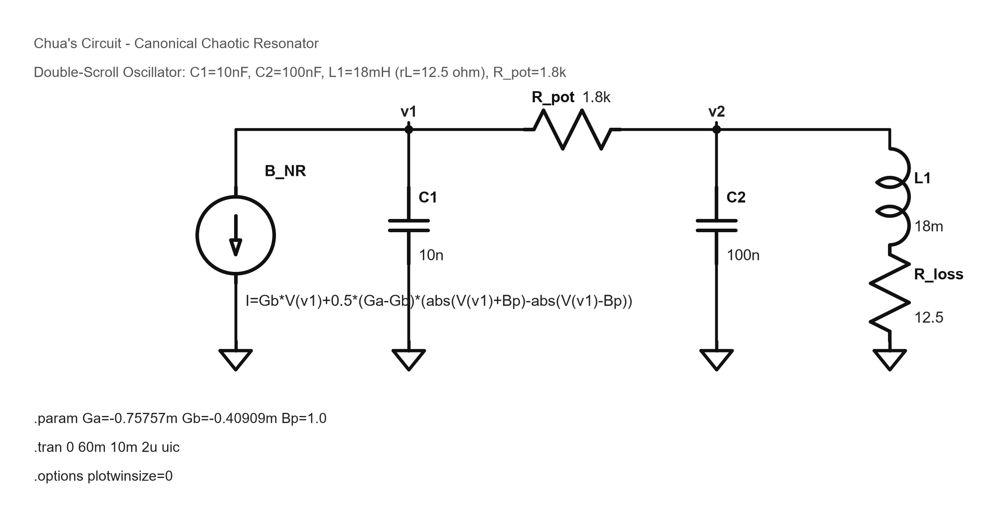
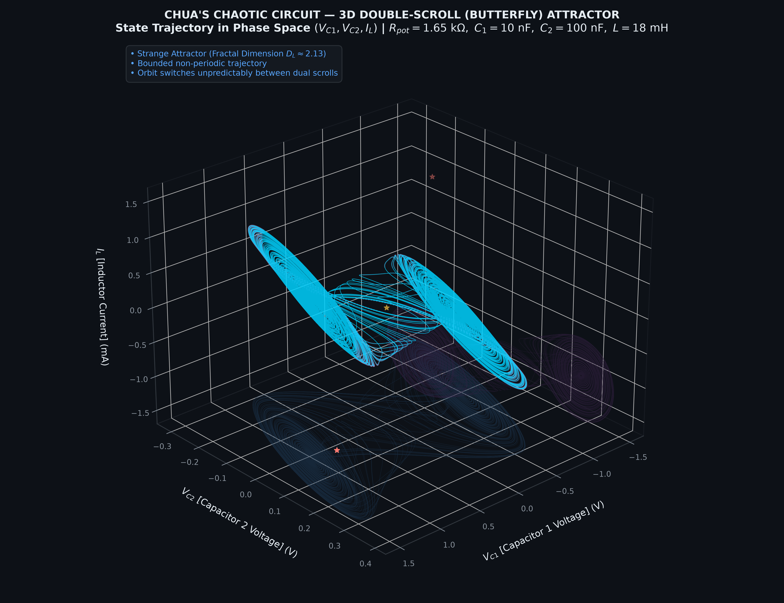
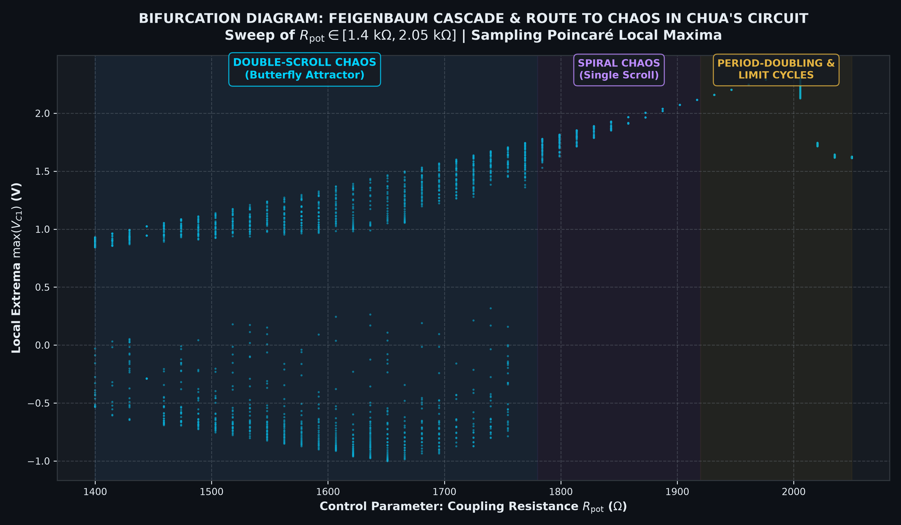
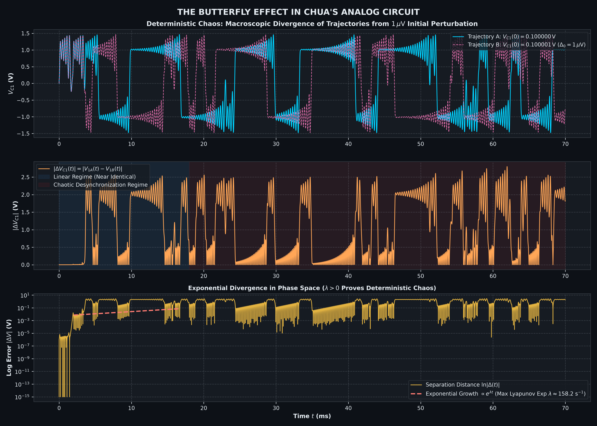
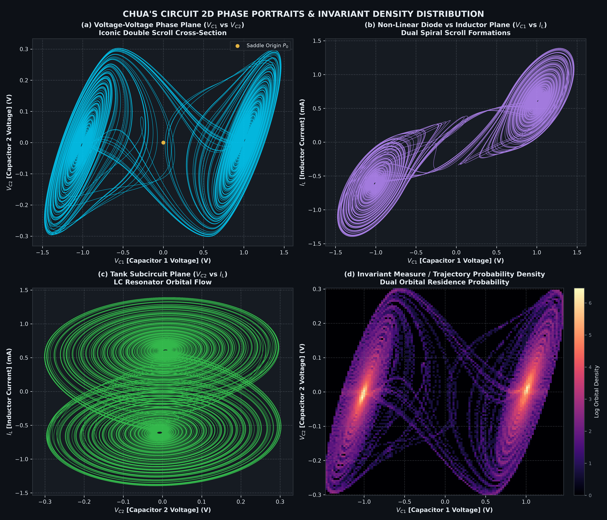
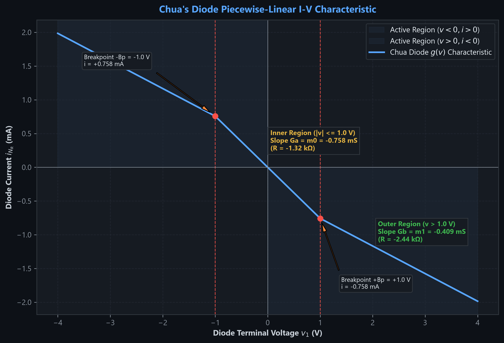
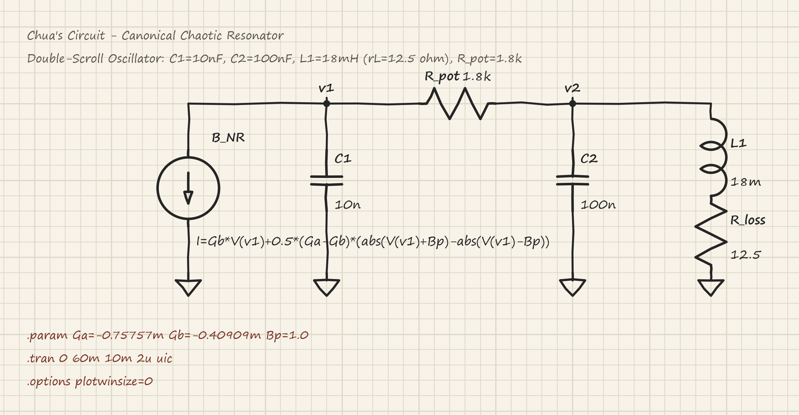
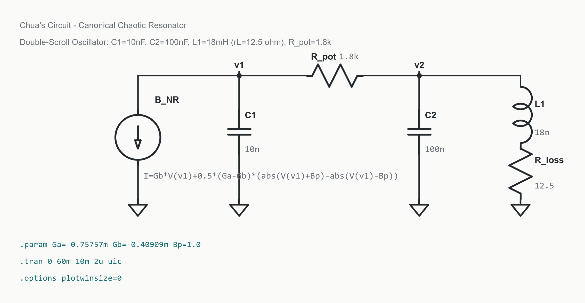

# SpiceMCP

LTspice MCP server where **the server owns the optimization state, not the LLM**.

The model contributes topology and strategy. Candidate identity, simulation history,
dedup, best so far, sensitivities and rollback all live in SQLite and are re derived
on every call, so a long optimization can't drift into remembering a circuit that
never existed.

> ### Prototype Status & Live Example
> **SpiceMCP is pre-1.0 (0.13).** Every drawn schematic and ready-made circuit is checked in LTspice 26 on Windows (`docs/reports/step7/REPORT.md`), and the test suite runs on Linux and Windows for every change. The tool names and inputs may still change before 1.0.
>
> Below is a demonstration of what SpiceMCP generated and analyzed autonomously for **Chua's Chaotic Circuit** showcasing automated `.asc` schematic generation, batch LTspice simulations, binary `.raw` waveform parsing, parameter sweeps, and visualization:
>
> | **Schematic Rendering (`render_schematic`)** | **3D Double-Scroll Attractor** |
> | :---: | :---: |
> |  |  |
> | *Vector schematic generated from `.asc` in `classic` style* | *3D phase-space trajectory $(v_{C1}, v_{C2}, i_L)$ parsed from binary `.raw`* |
>
> | **Bifurcation Route to Chaos (`simulate` sweep)** | **Sensitivity to Initial Conditions (Butterfly Effect)** |
> | :---: | :---: |
> |  |  |
> | *Multi-point parameter sweep capturing period-doubling cascades* | *Lyapunov divergence tracking $1\,\mu\text{V}$ initial condition perturbations* |
>
> | **2D Phase Plane Portraits & Orbital Density** | **Nonlinear Diode (NDR) I-V Curve** |
> | :---: | :---: |
> |  |  |
> | *Orthogonal projections ($V_{C1}-V_{C2}, V_{C1}-I_L$) with orbital density* | *Piecewise-linear Negative Differential Resistance ($G_a, G_b$) DC sweep* |


## Circuits built so far

**17 circuits.** Every one with its schematic, simulated plot and key result: [docs/circuits/SpiceMCP_Circuit_Catalog.pdf](docs/circuits/SpiceMCP_Circuit_Catalog.pdf). Text list: [docs/CIRCUITS.md](docs/CIRCUITS.md).

| No. | Circuit | Key result |
|---:|---|---|
| 1 | RC low-pass filter | 1000.0 Hz cutoff for a 1 kHz spec |
| 2 | Sallen-Key low-pass filter | 9998 Hz for a 10 kHz spec, 40 dB/decade |
| 3 | Non-inverting amplifier | 20.00 dB gain, 1.12 MHz bandwidth |
| 4 | LDO regulator (5 V to 3.3 V) | 3.301 V, 72° phase margin |
| 5 | Buck converter (12 V to 5 V, closed loop) | 33 mV ripple, 89.5% efficient |
| 6 | Instrumentation amplifier (gain 100) | 127 dB hum rejection, 104 kHz bandwidth |
| 7 | Inverting amplifier | drawn clean, score 100 |
| 8 | Common-source MOSFET amplifier | drawn clean, score 99 |
| 9 | Wheatstone bridge | drawn clean, score 99 |
| 10 | Boost converter | drawn clean, score 100 |
| 11 | Two-stage amplifier with feedback | drawn clean, score 100 |
| 12 | Pi filter | drawn clean, score 100 |
| 13 | 5-stage RC ladder | drawn clean, score 100 |
| 14 | LC tank | drawn clean, score 100 |
| 15 | Two-stage CMOS op-amp (8 MOSFETs) | 87.5 dB gain, 10 MHz unity-gain |
| 16 | Comparator with gate drive | drives the buck's power MOSFET |
| 17 | Chua's chaotic circuit | double-scroll attractor (gallery above) |

Circuits 1 to 14 were each drawn by SpiceMCP and read back by LTspice as the same circuit.

**Engineering report:** [docs/final/SpiceMCP_Engineering_Report.pdf](docs/final/SpiceMCP_Engineering_Report.pdf) is a pictorial before/after summary of versions 0.6 to 0.13, written for circuit designers.

## Architecture

```mermaid
flowchart TB
    subgraph Client ["LLM / MCP Client"]
        Agent["AI Agent / LLM<br/><i>(Topology & Optimization Strategy)</i>"]
    end

    subgraph Server ["SpiceMCP Server (FastMCP API)"]
        direction TB
        subgraph ToolEndpoints ["Tool Endpoints (11 Tools)"]
            T_Life["<b>Lifecycle Tools</b><br/>start_optimization<br/>finish_design"]
            T_Eval["<b>Evaluation & Search</b><br/>run_optimization<br/>evaluate_candidate"]
            T_Sim["<b>Simulation & Sweeps</b><br/>simulate"]
            T_Diag["<b>Feasibility & System</b><br/>check_feasibility<br/>check_setup"]
            T_Vis["<b>Schematics</b><br/>render_schematic"]
            T_Query["<b>State Queries & Reports</b><br/>query_run (status / best / pareto /<br/>history / sensitivity / compare / ...)<br/>generate_design_report<br/>rollback_to_candidate"]
        end
    end

    subgraph Core ["Optimization & Circuit Core"]
        Engine["<b>Optimization Engine</b> (engine.py)<br/>• Coordinate descent & step halving<br/>• Pure-function scoring & Pareto frontier<br/>• Empirical sensitivity analysis (FD / OLS)"]
        IR["<b>Circuit IR & Hashing</b> (ir.py)<br/>• Template placeholder substitution: {param}<br/>• Fingerprinting (topology, design, config)<br/>• Deterministic deduplication"]
        ASC["<b>Schematic Writer</b> (asc.py)<br/>• Pin-name routing with symbol (.asy) parsing<br/>• Orthogonal L-routing (HV/VH/auto)<br/>• Round trip netlist validation via asc.check()"]
        Render["<b>Schematic Renderer</b> (render.py)<br/>• Real .asy geometry & transformation matrices<br/>• SVG (zero dependency) and PNG (matplotlib)<br/>• 3 styles: tech_minimal, classic, sketch<br/>• Label collision avoidance"]
        Robust["<b>Robustness & Waves</b> (robustness.py, raw.py)<br/>• DC operating point & bias audit<br/>• PVT corners & Monte Carlo yield / Cpk<br/>• Binary .raw parser & waveform metrics"]
        Feas["<b>Preflight Feasibility</b> (feasibility.py)<br/>• 3 tiers: static, template, physics<br/>• 3 modes: practical, theoretical, concept<br/>• Closed form limits (SR, GBW, noise, filter order)"]
        Rep["<b>Design Report & Plots</b> (report.py, plots.py)<br/>• Six-section Markdown, rendered from state<br/>• BOM, baseline vs final, Bode/tran/THD figures<br/>• Unified 5-color visualization ramp & chrome"]
    end

    subgraph Simulation ["Simulation Layer (sim.py)"]
        Router{"Backend Router"}
        LTSpice["<b>LTspice Executable</b><br/>Batch process (<code>-b -ascii</code>)"]
        Analytic["<b>Analytic Backend</b><br/>Fast closed form surfaces (test/dry-run)"]
        SweepEngine["<b>Sweep Engine</b><br/>Single launch <code>.step</code> multipoint execution<br/>Value recovery from .log / .raw"]
        MeasParser["<b>Log & Meas Parser</b><br/>• .meas regex metric extraction<br/>• Complex AC magnitude/phase parsing<br/>• Failure taxonomy classifier"]
    end

    subgraph State ["Authoritative State (.ltspice-mcp/)"]
        subgraph DB ["SQLite Database (state.db - WAL Mode)"]
            T_Runs[("<b>runs</b><br/>Templates, parameter bounds, objectives")]
            T_Designs[("<b>designs</b><br/>Byte exact netlists, lineages, SHA hashes")]
            T_Exps[("<b>experiments</b><br/>Metrics, scores, feasibility, failures")]
            T_Sens[("<b>sensitivities</b><br/>Slopes, R2, confidence")]
        end
        subgraph FS ["Filesystem Artifacts"]
            CandDir["<code>candidates/</code> (cand_XXXX.cir)"]
            SimDir["<code>simulations/</code> (adhoc, sweep, logs, raw)"]
            RepDir["<code>reports/</code> & <code>plots/</code>"]
        end
    end

    %% Communication Flow
    Agent -->|"1. Tool calls (goals, param space, evaluations)"| ToolEndpoints
    ToolEndpoints -->|"6. Compact summaries, sensitivities, best candidates"| Agent

    T_Life & T_Eval & T_Query --> Engine
    T_Sim --> Router
    T_Diag --> Feas
    T_Diag --> Router
    T_Vis --> Render
    Engine -->|"Refuse impossible specs before any state is written"| Feas
    Engine --> IR
    Engine --> Robust

    Engine -->|"Execute candidate sim"| Router
    Router -->|"Subprocess"| LTSpice
    Router -->|"In-memory"| Analytic
    Router --> SweepEngine
    LTSpice -->|"Parse .log / .raw"| MeasParser
    SweepEngine --> MeasParser
    Analytic --> MeasParser
    MeasParser -->|"Extracted metrics & failure status"| Engine

    IR -->|"Query existing fingerprints"| T_Designs
    Engine -->|"ACID Transaction (append only history)"| DB
    Engine -->|"Store byte exact netlists & traces"| FS
    T_Query -->|"Rederive dynamically (best, pareto, sensitivities)"| DB
    T_Query --> Rep
    Rep -->|"Read stored state, never hand entered numbers"| DB
    Rep -->|"Resimulate the winner for waveforms & corners"| Robust
    Rep -->|"Write DESIGN_REPORT.md + figures"| RepDir
    ASC -.->|"Round trip verification"| LTSpice
    Render -.->|"Parse .asy symbol definitions"| FS

    %% Styling based on SpiceMCP visual style palette
    classDef client fill:#f9f9f9,stroke:#333,stroke-width:2px,color:#333
    classDef endpoint fill:#1E56A0,stroke:#12396e,stroke-width:2px,color:#fff
    classDef core fill:#38A3A5,stroke:#23696a,stroke-width:2px,color:#fff
    classDef sim fill:#E07A5F,stroke:#9c5340,stroke-width:2px,color:#fff
    classDef db fill:#D9534F,stroke:#933734,stroke-width:2px,color:#fff
    classDef fs fill:#F2CC8F,stroke:#a68a5d,stroke-width:2px,color:#333

    class Agent client
    class T_Life,T_Eval,T_Sim,T_Diag,T_Vis,T_Query endpoint
    class Engine,IR,ASC,Render,Robust,Feas,Rep core
    class Router,LTSpice,Analytic,SweepEngine,MeasParser sim
    class T_Runs,T_Designs,T_Exps,T_Sens db
    class CandDir,SimDir,RepDir fs
```



## Install

```bash
pip install spicemcp            # from PyPI, once published
pip install -e ".[dev]"         # from a clone, with the test tools
pytest -q
```

Settings (environment variables, all optional):

| variable | default | meaning |
|---|---|---|
| `SPICEMCP_PROJECT` | current folder | where runs, netlists and reports are kept |
| `SPICEMCP_BACKEND` | `ltspice` | `ngspice` where LTspice is not installed |
| `LTSPICE_EXE` | auto-detected | full path to LTspice |
| `SPICEMCP_WORKERS` | CPU cores, up to 8 | simulations run at the same time |
| `SPICEMCP_CALL_BUDGET_S` | 50 | longest a tool call blocks before answering |

Long calls: `run_optimization` returns at the time limit with its progress saved (call
it again to continue). `finish_design` keeps working in the background and answers
"still running"; call it again for the same run to get the result. Both send MCP
progress notifications.

Built-in blocks: place `X1 in+ in- V+ V- out SPMCP_OA` (op-amp, 2 MHz) or
`X1 in+ in- V+ V- out SPMCP_CMP` (comparator with gate drive) in any netlist; the
subcircuit is added for you.

LTspice is auto-detected (`AppData\Local\Programs\ADI\LTspice\LTspice.exe`,
`Program Files\LTC\LTspiceXVII\XVIIx64.exe`, …). Override with `LTSPICE_EXE`.
Without LTspice (Linux, macOS), install ngspice and set `SPICEMCP_BACKEND=ngspice`.

Register with your MCP client:

```json
{
  "mcpServers": {
    "spicemcp": {
      "command": "python",
      "args": ["-m", "spicemcp.server"],
      "env": { "SPICEMCP_PROJECT": "C:/path/to/your/circuit/project" }
    }
  }
}
```

State lands in `$SPICEMCP_PROJECT/.ltspice-mcp/`:

```
state.db      authoritative state (SQLite WAL)
candidates/   cand_XXXX.cir, byte exact netlists for rollback
simulations/  LTspice working dirs, logs, and raw waveforms
reports/      Markdown design reports and iteration traces
plots/        Rendered Bode, transient, and THD figures
```

## Metrics come from `.meas`

Every metric you optimize on is a `.meas` directive in the netlist, and the server reads
the values back from LTspice's `.log`. The metric definitions then live with the circuit,
versioned alongside it. Waveforms are a separate concern: `spicemcp.raw` parses the binary
`.raw` for the report's plots and for a sweep with no `.meas`, but nothing in the search
loop scores a candidate off a wave.

```spice
.ac dec 100 1 10Meg
.meas AC gain_db MAX mag(V(out))          ; mag(), NOT db() (see below)
.meas AC bandwidth WHEN mag(V(out))=0.707 FALL=1
.meas TRAN power AVG (-I(V1)*V(vcc))
```

**Never wrap an AC `.meas` in `db()`.** LTspice already reports AC measurement
magnitudes in dB, so `db()` converts twice without throwing an error, returning a
smaller plausible number. Verified on 26.0.2: a gain of 100 measures as `40dB` via
`mag()` but `32.04dB` (= 20·log10(40)) via `db()`. The server lints for this and
returns a warning alongside the metrics.

AC results are complex, so the phase is available too, as `<name>_deg`:

```
gdb: MAX(mag(V(out)))=(40.0dB,-159.417738334°)   ->  gdb = 40.0, gdb_deg = -159.42
```

One more trap, because two `.meas` forms print the same shape with opposite meanings:

```
bw:   mag(V(out))=0.7071  AT 159158.003411       -> 159158  (WHEN: the crossing)
p050: V(out) =0.140915020014 at 6.666666667e-05  -> 0.1409  (FIND AT: the value)
```

In a `WHEN` measure the number after `=` is the trigger level you specified and `AT`
carries the result; in `FIND ... AT` it is the reverse. LTspice separates them only by
case (uppercase `AT` for a point it found, lowercase `at` for one you specified), so
the parser is case sensitive here. Getting it backwards returns the sample time as the
measurement, which plots as a plausible straight line.

## Topology library: start from a known circuit

Most designs start from a known topology sized by textbook equations. `list_templates`
shows five ready-made circuits, and `start_from_template` turns a short spec into a run.
It writes the netlist with its measurements, sizes the parts by hand equations (the
working comes back line by line), and simulates that start point:

```python
start_from_template(run_id="buck_001", template="buck",
                    spec={"vin": 12, "vout": 5, "iout": 1, "ripple_mv": 50})
run_optimization(run_id="buck_001", iterations=20)
```

| template | spec |
|---|---|
| `rc_lowpass` | `fc` |
| `sallen_key_lowpass` | `fc`, `q` (default 0.707, Butterworth), `cload` (100 pF) |
| `noninverting_amp` | `gain`, `bw`, `gbw` (op-amp, default 10 MHz), `cload` (100 pF) |
| `ldo` | `vin`, `vout`, `iload`, `dropout` (0.3 V), `cout` (1 µF), `step_pct` (3 %) |
| `buck` (closed loop, `vin` 4 to 20 V) | `vin`, `vout`, `iout`, `fsw` (500 kHz), `ripple_mv` (50) |

Goals and limits can name a part directly as `param_<NAME>` (for example "smallest
`param_c1`"). Each template's hand-sized start is simulated in the test suite.

The templates use real devices, not ideal stand-ins. The op-amp in the Sallen-Key, the
non-inverting amplifier and the LDO's error amplifier is a transistor-level two-stage
CMOS op-amp (`opamp.py`: PMOS input pair, current-mirror load, common-source second
stage, Miller compensation) running from its own supply pins. Its gain, bandwidth,
output swing, loading and slew come from the MOSFETs. The buck switches a P-channel power
MOSFET (`VDMOS`, with on-resistance and gate capacitance) from a gate driver. The op-amp
uses the usual 5-pin order (in+ in- V+ V- out), so a vendor macromodel with the same
pins can replace it. Report: `docs/reports/step6/REPORT.md`.
Report: `docs/reports/step3/REPORT.md`.

**Stability is checked with every simulation.** A netlist may hold several decks, one
after another, each ending in `.end`; each is run on its own and the measurements are
merged. The op-amp circuits and the LDO carry a second deck with the feedback loop broken
at the amplifier input (a 1 kH inductor keeps the bias, a 1 kF capacitor injects the
test signal), which measures `pm_deg` (phase margin) and `ugf` (crossover), and they
carry a `pm_deg >= 45` limit. The LDO also has a load-step deck (10 % to 100 % load:
`step_mv`, `kick_mv`) and sizes the resistor in series with its output capacitor that
makes its loop stable. The buck is closed loop: an integrating error amplifier, a
comparator against a ramp and a push-pull gate drive set the duty cycle, so the output
holds when the input or the parts move. Report: `docs/reports/step8/REPORT.md`.

On a machine without LTspice, `sim_options={"backend": "ngspice"}` runs the same LTspice
deck through ngspice, translating the `.meas` lines on the fly. LTspice stays the main
simulator. ngspice is for CI, Linux/Mac, and checking results.

## Preflight: is the spec even possible?

`check_feasibility` answers that before a single LTspice process starts. It costs no
simulation and no tokens beyond the call, and it exists because the expensive failure
mode is an optimization loop that runs 40 iterations against a requirement no topology
can meet, then reports a confident near miss.

```python
check_feasibility(
  goals=[{"metric": "slew_rate", "direction": "max"}],
  limits=[{"metric": "slew_rate", "min": 1e8}, {"metric": "power", "max": 0.0005}],
  circuit_type="opamp", mode="concept",
  tech={"vdd": 1.8, "cload": 10e-12})

# status: "infeasible", passed: false
# power_below_dynamic_floor: power < 0.0005 W, but the slew requirement alone draws
#   0.001 A from 1.8 V = 0.0018 W, before bias, output stage or reference current
# suggestion: raise the power limit above 0.0018 W, drop C_load, or relax the slew
#   requirement
# details: theoretical_min_power = 0.0018, power_floor_from = "slew"
```

Three layers, each reported separately so you can tell a typo from physics:

| layer | catches |
|---|---|
| `static` | contradictory bounds (`fc > 10k` and `fc < 9k`), over unity efficiency, inverted or empty `param_space`, `P_max < Vdd·I_load` |
| `template` | an objective or constraint with no `.meas` that produces it, `{PARAM}` vs `param_space` mismatches in both directions, gain > 1 demanded of an R and C only deck, reactive element count vs the filter order the mask needs |
| `physics` | closed form limits per `circuit_type`: filter order (Butterworth, Chebyshev, elliptic), `SR ≤ I/C_L`, `GBW ≤ gm/2πC_L` against both bias current and `f_T`, `4kTR` and `kT/C` noise floors, LDO dropout / headroom / `Vout/Vin` efficiency ceiling, boost without inductor, duty cycle |

`mode` picks how strict: `practical` (physics plus engineering guidelines: R > 100 MΩ,
C < 0.1 fF, phase margin under 45°, W/L over 1000), `theoretical` (hard limits only),
`concept` (no netlist needed, for checking an idea before writing a deck).

`status` is one of four outcomes:

* **`infeasible`**: a hard bound is violated. `passed` is false. Every error here is a
  bound that holds for any topology, derived from a definition or conservation law,
  so the requirement must be adjusted.
* **`impractical`**: buildable, with flagged engineering concerns. `passed` is true.
* **`feasible`**: nothing ruled it out and every applicable check completed successfully.
* **`unverified`**: nothing ruled it out but a relevant check could not run,
  usually due to a missing `technology_params` entry. It outranks `impractical`, because a
  warning is visible in `violations` either way while a silently skipped physics check
  reads as a pass. What was skipped is listed in `checks_skipped`.

`start_optimization` runs the same check first and **does not create the run** when a
requirement is impossible: the answer carries the violations and suggested fixes
instead, and no state is written. Warnings ride along and block nothing.

```python
start_optimization(..., skip_preflight=True)    # skip the check entirely
start_optimization(..., circuit_type="ldo")     # also run the LDO physics checks
```

For the physics checks that need technology values (`vin`, `cload`, ...), call
`check_feasibility(..., tech={...})` first.

The check is skipped for `backend: "analytic"`: those metrics come from a registered
Python function, so `.meas` directives and `{PARAM}` placeholders mean nothing there and
every template check would be a false positive.

## Usage

`start_optimization` once, then let `run_optimization` do the iterating:

```python
start_optimization(
  run_id="amp_001",
  netlist=open("amp.cir").read(),   # tunables written as {R1}, {C1}
  params=[{"name": "R1", "min": 1e3, "max": 100e3},
          {"name": "C1", "values": [1e-9, 4.7e-9, 1e-8]}],
  goals=[{"metric": "gain_db",   "direction": "max"},
         {"metric": "bandwidth", "direction": "max"},
         {"metric": "power",     "direction": "min"}],
  limits=[{"metric": "bandwidth", "min": 100000},
          {"metric": "power", "max": 0.005}],
  seed=42)

run_optimization(run_id="amp_001", iterations=40)   # 40 sims, ONE compact answer
```

A two-sided bound is one entry: `{"metric": "fc", "min": 9500, "max": 10500}`. Limits
are inclusive (`>=` / `<=`). Inputs are strict: a misspelled key, `min` above `max`, or
the old string form `"<0.005"` is rejected before anything runs.

How the search works: it first spreads a few points over the whole range (a Latin
hypercube, 2 per parameter), then refines the best one. Any positive range of 10x or more
is searched in log steps (`"scale": "auto"`, or force `"log"` / `"linear"` per param), so
1 Ω..1 MΩ gets equal effort per decade. When limits are coupled (a Sallen-Key's fc and Q),
the engine measures each metric's log slope against each part and solves one joint move
that lands all of them inside their windows. Evaluate a hand-sized start point first and
the global sample is skipped. Benchmarks: `docs/reports/step2/REPORT.md`.

`run_optimization` returns a summary rather than an entire transcript: best candidate, constraint
status, the strongest measured sensitivity, the most promising unexplored region,
`step_frac_final` (how far the step had to shrink), and `at_param_space_bound` (which
parameters sit on a `min`, `max`, or list edge). That last one matters: a bounded search
always reports an optimum, and if the winner is pinned to the boundary, the
proper action is to widen `param_space` rather than assume convergence.

The full history stays queryable but never arrives unasked.

## Schematics from LTspice's own parts

`spicemcp.asc` writes a real `.asc` using LTspice's symbol library, so a candidate opens
as a schematic you can probe and edit, rather than as a netlist in a text window. Pin offsets
are read from the actual `.asy`, which means `res`, `cap`, `OpAmps/opamp`, `nmos`, `npn`
and everything else in `lib/sym` work with no per part table.

Wire by **pin name**; nothing takes a pin coordinate:

```python
from spicemcp import asc
sh = asc.Sheet()
V1 = sh.part("voltage", "V1", (0, 80), value="AC 1")
R1 = sh.part("res", "R1", (80, 112), "R270", value=1849.60938)
U1 = sh.part("OpAmps/opamp", "U1", (480, 176), "M180",
             SpiceLine="Aol=1Meg", SpiceLine2="GBW=1G")
sh.net(V1["+"], R1["A"])
sh.route(R1["B"], U1["noninvin"], "VH")     # L shaped, no intermediate points
sh.gnd(V1["-"]);  sh.flag(U1["out"], "out")
sh.directive(".lib opamp.sub", ".ac dec 400 100 1Meg")
assert "XU1 out b out opamp" in asc.check(sh.write("f.asc"))
```

`check()` netlists the drawing back through LTspice and returns its element lines. Use
it: it is the only way to know the picture is the circuit you meant. A wrong
orientation or an unwired pin produces a schematic that opens and simulates happily,
and comparing against the candidate netlist is what catches it. Directives and notes
auto stack above and below the drawn content, so text placement isn't a coordinate
either.

Use the library part, not an equivalent model: `E1 out 0 in out 1e6` is a VCVS, and
`OpAmps/opamp` is a single pole amplifier with `Aol` and `GBW` you can dial. `GBW` is a
functional knob: on a 10 kHz Sallen-Key, going from an ideal
`GBW=1G` to the block's own `GBW=10Meg` default moves the corner 1.55 Hz and the step
overshoot from 5.76% to 5.81%.

`connect(a, b)` is the general form: same axis creates a straight wire, and two pins that share
neither axis receive a two segment L through one corner (`HV` across then up, `VH` up then
across, `auto` longer leg first). Never a diagonal, because LTspice draws a diagonal
line without connecting anything at either end, and `auto` is a pure function of the two
coordinates, ensuring deterministic schematic output across runs.

## From optimised values to a parts list

An optimiser's best design says `C1 = 1.5915 nF`, and nobody sells that part.
`finish_design` turns the best design into one you can order, and tells you how many
boards will work:

```python
finish_design(run_id="lpf_001")                       # R: E96 1%, C: E12 5%, L: E12 20%
finish_design(run_id="lpf_001", capacitors="E24", tolerance_pct={"C": 1})
finish_design(run_id="ldo_001", supply="Vin", supply_tol_pct=5)
```

1. The coarse-step parts (usually capacitors, E12) are tried at the standard values
   just below and above their optimised value.
2. For the best two choices, every remaining free value (the fine-step resistors, a duty
   cycle, a transistor width) is re-centred to maximise the worst margin to any limit.
   This is what an engineer does by hand: pick the capacitors, recompute the resistors.
3. The fine-step parts are then picked from their series the same way.
4. The best few sets get a Monte Carlo yield run (default 30 boards): every part is
   drawn uniformly inside its tolerance, and optionally the supply inside its own.
   The set with the highest yield is returned as a parts list, with the margin.
   The yield is stated honestly: `30/30 pass: yield is at least 90% (95% confidence)`
   (a one-sided Clopper-Pearson bound). Each call draws new boards from a fresh random
   `seed`, which is reported; pass `seed=` to repeat a run exactly.
5. The answer is kept short. The spread of every metric, the alternatives and the
   optimiser's own numbers are on `query_run(run_id, what="details")`.

On the templates, plain rounding to the nearest standard value breaks the RC and the
Sallen-Key filters (the corner frequency leaves its window), and `finish_design` finds
sets that meet every limit. The yield numbers then say what the tolerances allow: a
±2% corner frequency is not reachable with 5% capacitors (45 to 65% yield), and is
100% with 1% parts. Report: `docs/reports/step5/REPORT.md`.

## Drawing a schematic from a netlist

Give `render_schematic` a SPICE netlist (`.cir`, `.net`, `.sp`) and it places and wires
the parts itself, writes an LTspice `.asc` next to the picture, and checks that drawing
before it returns:

```python
render_schematic("filter.cir", "filter.png")   # -> filter.png + filter.asc
```

* Signal flows left to right: an amplifier's inputs sit to the left of its output.
* Ground is at the bottom: every part with one end on ground hangs down from its node
  and has its own ground symbol, so there are no ground wires to follow.
* The main path sits on one row. A part that bridges distant nodes, such as a feedback
  resistor or a Sallen-Key's bootstrap capacitor, goes on its own lane above or below.
* MOSFET amplifiers stand upright, drain above source. A pass device on a supply rail
  (an LDO, a high-side switch) lies on its side in the power path.
* Wires are right angles only. They never run through a part, never end on another
  net's wire, and cross another net only when they have to. A connection that would need
  a long detour becomes a pair of net labels instead. Measured nodes are labelled.

**Every drawing is checked.** The geometry is read back the way LTspice joins it (wire
ends, tees, pins and same-named labels) and compared with the netlist, pin by pin. A
drawing that is not the same circuit is refused, never returned. This check needs no
LTspice, and on Windows `asc.check()` can still netlist the file through LTspice itself.
`layout.lint()` scores readability (crossings, wires through parts, overlaps, hidden
connections, dangling ends) and the score comes back with the picture.

`start_from_template` also draws its circuit, so a templated run has a schematic from
its first step. A 5-pin op-amp subcircuit is drawn as LTspice's `opamp2` symbol with
rail labels on its supply pins, and its `.subckt` is written beside the `.asc` as a
`.lib`. Without an LTspice install, a small bundled symbol set (R, C, L, D, sources,
controlled sources, switch, MOSFETs, op-amp) stands in. A real LTspice library always
takes priority. Report: `docs/reports/step4/REPORT.md`.

## Rendering a schematic

`render_schematic` also draws an `.asc` that is already on disk. Every symbol's geometry comes out of
its own `.asy` transformed by that instance's orientation, so a resistor is the zigzag
LTspice draws and an op amp has its inverting input where the symbol puts it; nothing is
reimagined from a netlist. Wires, junction dots, net labels, power rails, grounds, ports,
pin names, designators, values and directives all come from the file.

```python
render_schematic("f.asc", "f.svg")                       # vector, stdlib only
render_schematic("f.asc", "f.png", "classic", dpi=300)    # PNG needs matplotlib
```

Three styles over identical geometry:
* **`tech_minimal`** (default): charcoal ink, with colour reserved strictly for signal information like inputs, outputs, and feedback paths.
* **`classic`**: monochrome, engineered for crisp print and formal publication.
* **`sketch`**: engineering notebook style on graph paper with subtle hand drawn variation, while preserving exact circuit topology.

The canvas is computed from the schematic's own bounding box, so nothing is cropped and there is no
empty page. The same file and style produce identical bytes every time: `sketch` wobble is
hashed deterministically from the geometry rather than drawn from an RNG. Label collisions are automatically detected and avoided.

## Visual style & colour palette

The MCP resource `spicemcp://style` exposes the exact design tokens and colour ramp used
across all schematic renders and waveform plots. Read this instead of guessing colours when
composing figures, documentation, or web interfaces that sit alongside SpiceMCP output.
It returns `default_style, schematic_styles, series, series_roles, chrome, fonts`.

Waveform plots (`generate_design_report`, `spicemcp.plots`) draw their traces from a unified
five colour data visualization ramp and their chrome from `tech_minimal`:

| role | token | default | usage |
|---|---|---|---|
| Primary trace | `C_TRACE` | `#1E56A0` | Main response curves (gain, step output, THD fundamental) |
| Secondary trace & bars | `C_TRACE2` | `#38A3A5` | Phase curves, input signals, FFT harmonic bars |
| Measured points | `C_MARK` | `#D9534F` | Critical points such as −3 dB cutoff, overshoot peaks, and unity crossings |
| Limits & specifications | `C_LIMIT` | `#E07A5F` | Target thresholds, mask boundaries, upper/lower bounds |
| Margin bands & tolerance | `C_BAND` | `#F2CC8F` | Settling error bands (±1%, ±0.1%) and tolerance envelopes |

The series ramp is a monotonic lightness sweep that degrades cleanly in greyscale printing,
while maintaining maximum hue contrast between the first two traces for dual axis plots.

## Sweeping a parameter

`simulate` with `sweep_param` and `sweep_values` runs one LTspice launch for the whole sweep via `.step`, and resolves the
parameter name against the deck so an ordinary netlist can be swept without being
reauthored as a template:

```python
simulate(netlist, sweep_param="temp",   sweep_values=[-40, 27, 125])  # .step temp list
simulate(netlist, sweep_param="{GAIN}", sweep_values=[10, 20, 50])    # placeholder
simulate(netlist, sweep_param="R1",     sweep_values=[1e3, 2e3, 5e3]) # literal value
```

One row per point, and each row's `value` is read back from what LTspice itself reported
rather than from what was requested. A point the simulator skipped cannot shift the rest
of the table onto the wrong values. `value_source` indicates the source of evidence: the
log's `.step` echo, the `.raw` sweep axis (a stepped `.op` leaves no echo in the log, so the
axis is the sole record), or `requested` for a row nothing reported. A deck with no `.meas`
still returns its points and its `raw_path`, plus a warning explaining why the metrics are
empty.

## The final design report

`generate_design_report` writes the entire report: six sections of Markdown where every number
is read out of `state.db` or out of a simulation launched while writing the file. Nothing is
hand entered, ensuring the report cannot disagree with the run it describes.

```bash
python -m spicemcp.report amp_001 --dc-audit --pvt --supply V1 --mc 100
# .ltspice-mcp/reports/amp_001_DESIGN_REPORT.md
```

```python
generate_design_report(run_id="amp_001", dc_audit=True, pvt=True,
                       supply="V1", monte_carlo=100, schematic="pics/amp.png")
```

| section | contents |
|---|---|
| 1: Executive summary | topology and what the run establishes, constraint scorecard |
| 2: Schematic & BOM | designators, optimized values in engineering units (`81.4 kΩ`, `12.2 nF`), tuning parameter mapping, tolerance, `.model` cards, link to the byte exact `.cir` |
| 3: Optimization & verification | `Metric │ Target │ Baseline │ Final │ Δ │ Status`, measured sensitivities with method, tradeoffs, bound warnings |
| 4: Waveform analysis | Bode (gain, phase, −3 dB, PM/GM), transient (rise, overshoot, ±1% and ±0.1% settling, slew), FFT/THD, with plots |
| 5: Robustness | per-device Vds/Vgs/Vth/current/region, PVT corners, Monte Carlo yield and Cpk |
| 6: Reproduction guide | open the `.cir`, the directives already in it, F9, Ctrl+L |

Sections 1, 2, 3, and 6 are free queries against stored state. The rest each cost LTspice launches,
so they are opt in: one shared rerun of the winner (which draws the plots and reports whether
fresh metrics still match stored ones), plus `dc_audit` (1 launch), `pvt` (5 launches), and `monte_carlo`
(1 stepped run rather than N separate launches).

**A section that did not run states that clearly and specifies which argument produces it.**
A reviewer reads a missing heading as "checked, nothing to report", so an unswept corner analysis prints as
`> **Not run.** … To include it: generate(con, run_id, pvt=True)` rather than being omitted or filled with zeros.
The same principle applies when `check_feasibility` reports `checks_skipped` at the beginning of the pipeline.
Two additional cases where missing data is made explicit:

* Monte Carlo **yield** is evaluated against the run's own constraints. Without an interval for
  a metric, the table is labelled as a spread and `pass` is reported accurately as unverified.
* No schematic is automatically generated from netlists alone, because netlists lack coordinates.
  Pass `schematic=` with an image drawn using `spicemcp.asc` and validated via `asc.check()`.

### Tools Reference

13 tools, each with a two-line description, typed inputs, and sensible defaults. The
tool list is about 2,500 tokens and answers are one-line JSON, because both are re-sent
to the model on every turn. Every answer ends with `next_step` (the call that most likely comes next), and every error carries
`fix` plus a correct `example` call, so even a small model can recover on its own.

| tool | purpose |
|---|---|
| `check_setup` | Show the LTspice path and project folder in use |
| `simulate` | One-off netlist run, or a one-launch sweep (`sweep_param`, `sweep_values`) |
| `check_feasibility` | Zero-sim check (static, template, physics) before spending simulations |
| `list_templates` | The ready-made circuits and the spec keys each needs |
| `start_from_template` | Build, hand-size and simulate a ready-made circuit as a new run |
| `start_optimization` | Create a persistent run: `params`, `goals`, `limits` |
| `run_optimization` | Let the server run N iterations; returns one summary |
| `evaluate_candidate` | Simulate one exact parameter set, with dedup and scoring |
| `query_run` | Read stored state: `what` = status, best, pareto, history, candidates, candidate, netlist, compare, similar, sensitivity, explored, failed, trace, next, runs, details (hand calculation, full feasibility report, finish_design alternatives) |
| `rollback_to_candidate` | Restore a byte exact past circuit and its metrics |
| `finish_design` | End a run: standard part values (E6 to E96), re-centred, with Monte Carlo yield |
| `generate_design_report` | Six section Markdown report with BOM, plots, DC/PVT/Monte Carlo |
| `render_schematic` | Draw a `.asc`, or auto-place and check a netlist, as SVG/PNG in 3 styles |

Upgrading from 0.5: the 15 `get_*` / `list_runs` / `select_next_experiment` tools are now
`query_run(what=...)`; `simulate_netlist` and `simulate_sweep` are `simulate`;
`check_ltspice` is `check_setup`; `get_visual_style` is the `spicemcp://style` resource.

## Guarantees worth knowing

* **A worse iteration cannot demote the incumbent.** `best_candidate` is a `MAX(score)`
  query, where `score` is a pure function of a candidate's metrics (using fixed reference
  scales defined at run creation). Nothing is overwritten, preventing state corruption.
* **Modification never mutates.** A changed parameter set creates a new candidate record (`cand_NNNN`)
  linked to its `parent_id`, preserving the complete derivation tree.
* **Duplicates are never resimulated.** Deduplication checks `sha256(design) + sha256(sim_config)`.
  Evaluating the same circuit under different conditions constitutes a distinct experiment rather than a duplicate.
* **`rollback_to_candidate` restores stored bytes directly from disk**, never a reconstruction.
* **Sensitivities are measured empirically.** The `finite_difference` method indicates direct
  causal pairs differing in a single parameter; `ols_marginal` indicates correlational fits across multiple runs.
* **Every parameter is screened initially.** Parameters without variance have zero measured
  sensitivity and cannot be selected by exploitation alone. Unmeasured parameters take priority
  over unexploited ones. For decade spaced discrete lists, steps move to adjacent entries rather than
  using proportional spans.
* **The search is scale free, cycles coordinates, and refines step sizes dynamically.**
  Coordinate descent accounts for dimensional scaling (e.g. farads vs ohms) by normalizing against
  parameter bounds, alternates across coordinates to avoid greedy fixation, and halves step sizes
  when progress stagnates to converge within narrow tolerance bands.
* **Failures are classified and remembered.** The engine records failure modes (`convergence_failure`,
  `structural_error`, `constraint_violation`, `numerical_instability`) to prevent redundant exploration of invalid parameter regions.

## Deliberate simplifications

| skipped | add when |
|---|---|
| scoring a candidate off a waveform (`raw.py` parses `.raw`, but objectives are `.meas`) | a metric genuinely cannot be expressed as `.meas` (requires wave to scalar processing) |
| Bayesian optimization / GP surrogate | a single sim is fast enough that ~30 evaluations is cheaper than surrogate model complexity |
| step halving on stagnation instead of line search | evaluations spent bracketing cost more than simple step halving bookkeeping |
| one parameter moves per iteration (coordinate descent) | metric surface has strong parameter interactions requiring full compass polling |
| component graph IR (topology edits are new templates) | programmatic topology rewriting is explicitly required |
| incremental sensitivity updates (O(n²) per iteration) | runs exceed several hundred candidates |
| `promising_unexplored_region` identifies the widest untried gap | directional search hints are needed (the main search already uses measured sensitivity) |
| report plot generation resimulates the winner | full waveform history is required for every intermediate candidate |
| preflight metric recognition uses standardized naming conventions | metric name collisions require explicit type annotations |
| `check_feasibility` inspects top level netlist elements | subcircuit internal pole modeling is required (handled during simulation in robustness) |
| W/L aspect ratio check requires explicit W and L parameters | device geometry is defined via unified size parameters or model cards |
| `render_schematic` applies single pass greedy label collision offsets | complex placement solver is required for high density schematics |
| the auto-placer draws flat netlists on one sheet; the only subcircuit it draws is a 5-pin op-amp | hierarchical designs need a block per subcircuit |
| `simulate_sweep` steps one parameter per launch | nested 2D parameter sweeps are needed (run sequentially across outer values) |

## Schematic rendering styles

`render_schematic` renders any `.asc` file into three distinct visual styles over identical circuit geometry:

| **Classic (`classic`)** | **Sketch (`sketch`)** | **Tech Minimal (`tech_minimal`)** |
| :---: | :---: | :---: |
|  |  |  |
| *Monochrome, high-contrast formal print style* | *Engineering notebook style on graph paper with deterministic hand-drawn wobble* | *Charcoal ink with semantic signal line and port highlighting* |

## Test suites & verification

* **Hallucination Loop Test** (`tests/test_hallucination_loop.py`): drives the adversarial sequence (improve, improve, best, worse, worse, improve) and verifies the incumbent survives, candidate identities remain immutable, duplicates are rejected without simulation, and sensitivities match analytical derivatives.
* **Visual Gallery** (`tests/gallery.py`): renders side by side comparison sheets of every schematic style and plot type into `gallery/index.html` using real `.asy` library symbols.
* **Preflight & Report Testing** (`tests/test_feasibility.py`, `tests/test_report.py`, `tests/test_robustness.py`): validates 3 tier feasibility checks, Monte Carlo yield and Cpk calculations, DC bias audits, and full Markdown report generation.
* **Rendering & Sweeps** (`tests/test_render.py`, `tests/test_sweep.py`, `tests/test_asc.py`): tests deterministic SVG and PNG rendering, symbol orientation matrices, collision offsets, and single launch parameter sweeps.

## License

MIT. See [LICENSE](LICENSE).
