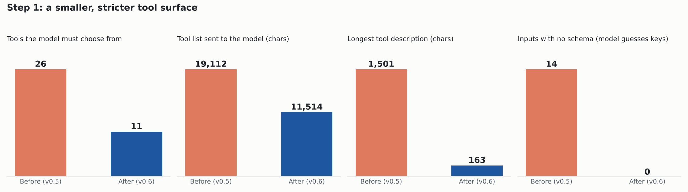
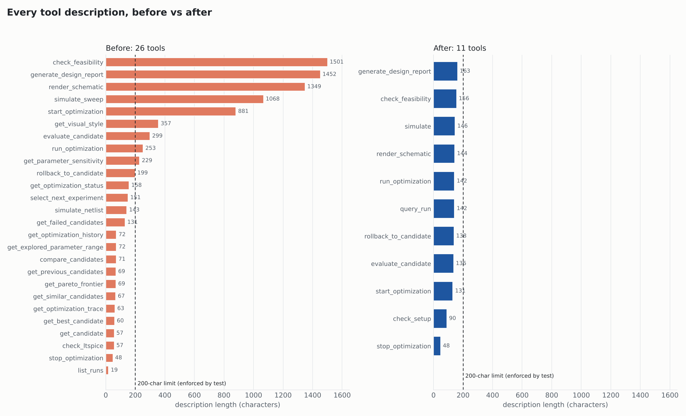
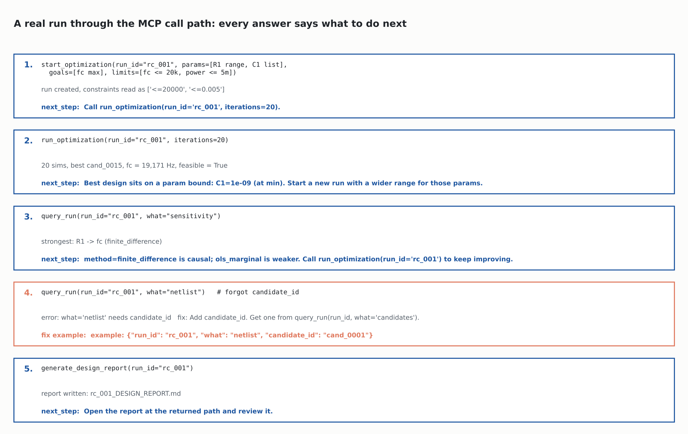

# Step 1 report: tools any LLM can use

Goal: a small or weak model should pick the right tool, fill in valid inputs on the first
try, and know what to call next, without reading a manual.

| | before (v0.5) | after (v0.6) |
|---|---|---|
| Tools | 26 | 11 |
| Tool list sent to the model | 19,112 chars | 11,514 chars |
| Longest description | 1,501 chars | 163 chars (limit 200, enforced by a test) |
| Inputs with no schema (model guesses the keys) | 14 | 0 |
| Answers with a `next_step` hint | 0 | all |
| Errors with `fix` + a correct `example` call | 0 | all |

## What changed

- 15 read-only tools (`get_*`, `list_runs`, `select_next_experiment`) are now one
  `query_run(run_id, what=...)`.
- `simulate_netlist` + `simulate_sweep` are now one `simulate`.
- `check_ltspice` is `check_setup`; `get_visual_style` is the `spicemcp://style` resource.
- Inputs are typed and strict: `params=[{"name","min","max"}|{"name","values"}]`,
  `goals=[{"metric","direction"}]`, `limits=[{"metric","min","max"}]`. The old string form
  `"<0.005"`, typo'd keys and `min > max` are rejected before anything runs.
- Every answer ends with `next_step`; every error has `fix` and an `example`.
- The server sends a 7-line workflow guide as MCP `instructions`.
- `mcp` is pinned below 2.0: mcp 2.x renamed `FastMCP`, so a fresh install of 0.5 broke.

## Walkthrough (real calls, analytic backend)

Step 2 shows the hint doing real work: the best design sits on the `C1` lower bound, and the
server says to widen that range instead of declaring victory.

Rebuild everything in this folder with `python docs/reports/step1/make_report.py`.
