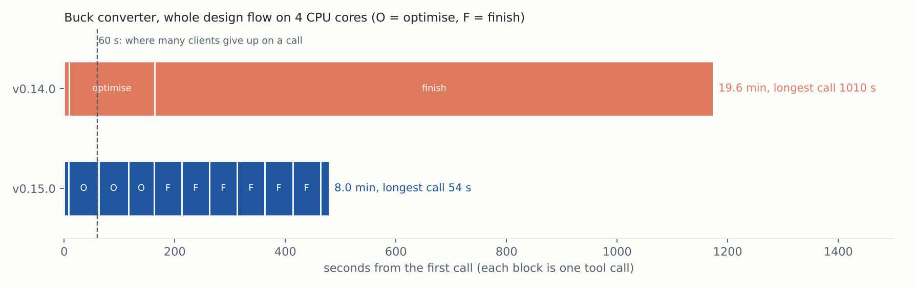
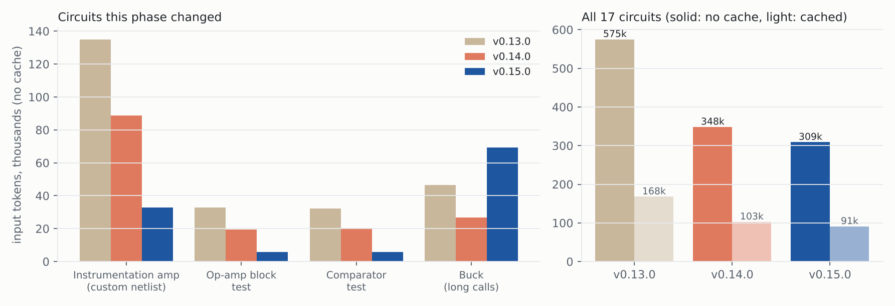

# Step 10: Phase 1, usable day to day (v0.15.0)

**In one line:** no tool call blocks for more than about a minute, the buck design takes
8 minutes instead of 20, the built-in op-amp and comparator are usable by name, and
everything works on ngspice and on both major versions of the MCP library.

Regenerate with `python docs/reports/step10/make_report.py`. Measured on a 4-core Linux
machine with ngspice, the same 17 flows as step 9 (`measure/run.py`), except: circuits 6,
15 and 16 use `SPMCP_OA` / `SPMCP_CMP` by name instead of copying the model out of a
template run, circuit 6 skips the separate `check_feasibility`, and the client follows
"still running" / "call again to continue" answers.

## 1. Time

| buck flow | v0.14.0 | v0.15.0 |
|---|---:|---:|
| total | 19.6 min | 8.0 min |
| longest single call | 1,010 s | 54 s |
| tool calls | 6 | 14 |

- `run_optimization` stops at `SPICEMCP_CALL_BUDGET_S` (50 s); state is saved, the next
  call continues. The optimiser itself is sequential (each step reads the last result);
  only its first screening moves now run side by side.
- `finish_design` runs in the background; its call returns after 50 s with "still
  running" and the next call for the same run returns the result. Standard-value
  combinations, re-centring neighbours and yield boards are simulated side by side
  (`SPICEMCP_WORKERS`, default one per core up to 8): 1,010 s → 322 s on 4 cores.
- Both send MCP progress notifications (checked over stdio: "3 of 20 simulations").

## 2. Tokens

| | v0.13.0 | v0.14.0 | v0.15.0 |
|---|---:|---:|---:|
| 17 circuits, no cache | 575k | 348k | 309k |
| 17 circuits, cached | 168k | 103k | 91k |
| instrumentation amp | 135k | 89k | 33k |
| op-amp block test | 33k | 20k | 6k |
| buck | 47k | 27k | 69k |

The buck went up: 14 short calls instead of 6 long ones, and each call re-reads the
conversation. With caching it is 12k. A client that keeps long calls alive with progress
notifications can raise `SPICEMCP_CALL_BUDGET_S`.

## 3. Other changes

- `simulate` and sweeps follow `SPICEMCP_BACKEND`; on ngspice a sweep is one simulation
  per value, side by side (Chua's circuit sweep now works there).
- `SPMCP_OA` / `SPMCP_CMP` are added to any netlist that places them, for simulation and
  drawing. The built-in copies are biased by a current source, so they work from 3 V up.
- Runs on `mcp` 1.x and 2.x (2.x renamed FastMCP to MCPServer); CI tests both.
- Packaged for PyPI: metadata, `python -m build` + `twine check` + a clean-wheel install
  in CI, and `.github/workflows/publish.yml` publishing on a `v*` tag via PyPI trusted
  publishing. The name `spicemcp` is free on PyPI; it needs the owner to register the
  trusted publisher once.
