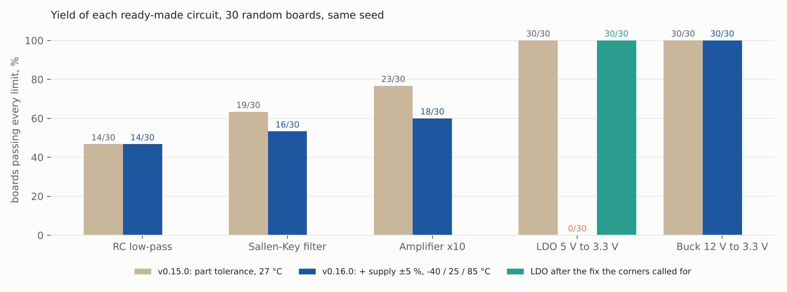

# Step 11: real parts, real temperatures, real stress (v0.16.0)

Phase 2 of the roadmap. Measured with ngspice on a 4-core Linux machine; every number
below is in `results.json`, `before.json`, `after.json`, `ldo_fixed.json` and
`noise.json`, produced by the scripts in `measure/`. Rebuild the picture with
`python docs/reports/step11/make_report.py`.

## Yield before and after the new checks

The five templates, start point straight to `finish_design` with the defaults, 30 boards,
seed 11. Before (v0.15.0): part tolerance at 27 °C. After (v0.16.0): part tolerance,
supply ±5 %, and -40 / 25 / 85 °C for circuits with transistors.

| circuit | v0.15.0 | v0.16.0 | what fails most (v0.16.0) |
|---|---|---|---|
| RC low-pass | 14/30 | 14/30 | fc, C1 high (no transistors: corners do not apply) |
| Sallen-Key filter | 19/30 | 16/30 | f3db, at -40 °C |
| Amplifier x10 | 23/30 | 18/30 | gain, at -40 °C, R2 high |
| LDO 5 V to 3.3 V | 30/30 | **0/30** | output at minimum input, at 85 °C |
| LDO, after the fix | | **30/30** | |
| Buck 12 V to 3.3 V | 30/30 | 30/30 | |

- The LDO result is a real fault the old check could not see: at 85 °C the PMOS pass
  device loses about 23 % of its drive (mobility falls as T^-1.5), so at dropout the
  output sagged to 3.196 V against a 3.234 V limit on every board. The template now sizes
  the pass device with its 85 °C KP and runs its dropout deck at 85 °C.
- The RC, filter and amplifier yields are low because 5 % capacitors and a ±2 % corner
  frequency (or ±0.1 dB gain) do not fit together; `next_step` now says which part to
  tighten. This is unchanged from v0.15.0 and is reported, not hidden.

## Part stress, buck (steady state, supply +5 %)

| part | measured | buy at least |
|---|---|---|
| M1 | Vds 13.1 V, RMS 0.79 A, edge spikes 6.2 A | 20 V, Id 1.2 A, Idm 6.2 A, Vgs 20 V |
| D1 | reverse 12.6 V, average 0.71 A | 20 V, 1.1 A |
| L1 | peak 1.14 A, RMS 1.0 A | Isat 1.5 A, Irms 1 A |
| C1 | peak 3.3 V | 6.3 V |

## Real parts

Buck with a Si4427BDY switch: 1N5819 diode, "too small: average current needs 1.07 A,
rated 1 A"; MBRS340, "ok: reverse voltage needs 15.7 V, rated 40 V; average current needs
1.07 A, rated 3 A". Sallen-Key on a library op-amp (TOA10): f3db within 0.1 % of target.
The test library (`tests/fixtures/lib`) has the LTspice layout; on a machine with
LTspice, `find_part` reads the thousands of vendor models it ships.

## Noise

Amplifier x10: 149 µV rms, 10 Hz to 1 MHz. Sallen-Key 10 kHz: 5.2 µV. With
`noise_uv: 120` the optimiser lowered R1/R2 from 10k/90k to 3.0k/27k and reached 117 µV.

## Cost

Tokens re-sent every turn (instructions + tool list): 2,776 → 3,004 (+8 %) for
`find_part`, `parts`, `temps_c`. The buck's finish_design takes longer: 30 boards x 3
temperatures x 3 decks.

## Limits

- Temperature moves transistors and diodes only; SPICE resistors and capacitors have no
  temperature coefficient unless a model gives one.
- Stress covers parts at the top level of transient and DC-sweep decks; AC-only circuits
  say "not checked". Loads (RL, CL) are the test bench and are left out.
- Encrypted vendor models run only in LTspice; ngspice drops LTspice-only rating fields.
