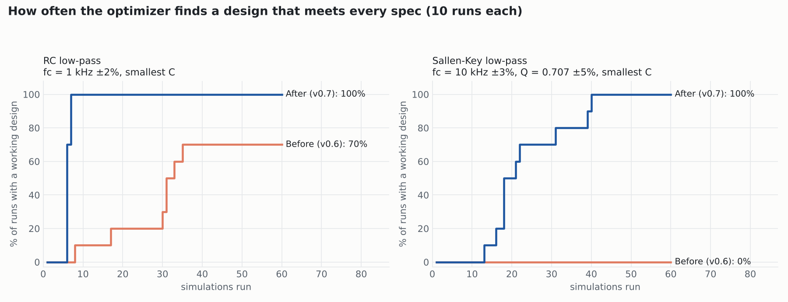
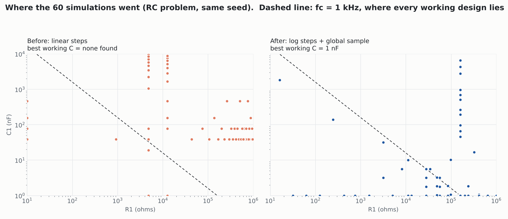
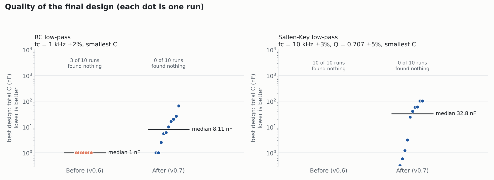

# Step 2 report: a search that works across decades

Benchmarked on two closed-form filter problems, 10 runs each, 60 simulations per run, same
seeds before and after. `bench_before.json` is the v0.6 engine and `bench_after.json` is the current one.

| problem | runs that met every spec | median sims to first working design |
|---|---|---|
| RC low-pass, fc = 1 kHz ±2% | 7/10 → **10/10** | 31 → **6** |
| Sallen-Key, fc = 10 kHz ±3% and Q = 0.707 ±5% | 0/10 → **10/10** | never → **20** |

## What changed in the engine
- **Log-scale steps** for any positive range of 10x or more (`scale: "auto"`; `"log"` and
  `"linear"` force it either way). A 25% step on 10 Ω..1 MΩ used to be 250 kΩ, so whole decades were skipped.
- **Global sample first:** a Latin hypercube with 2 points per parameter (4..12) spreads over
  every decade before local refinement starts. It is skipped when you evaluate your own
  hand-sized start point.
- **Joint repair of coupled limits:** the engine measures how each metric scales with each
  part (log elasticity: fc ∝ R⁻¹C⁻¹ gives -1). It then solves for one move that puts every
  limited metric back inside its window. This is what makes Sallen-Key fc **and** Q reachable.
  For safety, each repair changes any part by at most 2x (a trust region).
- **Slide along a limit:** after a push that improves the goal but breaks a limit slightly,
  the engine repairs that point instead of going back. This is how it walks the fc = 1 kHz line toward the smallest capacitor.

## Known limits
- Final values vary a lot between runs (see the dot plot). The search finds a working
  design reliably, but not always the best one.
- After converging, the remaining budget goes to exploring gaps (the vertical column in the map).
