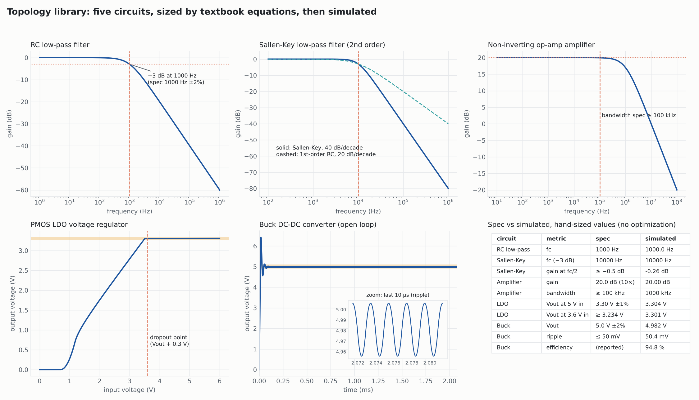
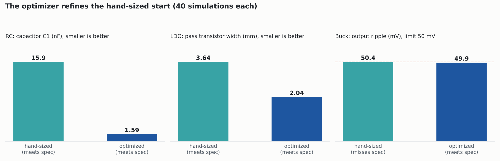

# Step 3 report: topology library with hand-calculated starting values

Five ready-made circuits. Each turns a short spec into a netlist with the measurements
already written, sizes it with the textbook equations, and simulates that start point.

| template | spec you give | hand-sized result (simulated) |
|---|---|---|
| `rc_lowpass` | fc | fc 1000.0 Hz for 1 kHz |
| `sallen_key_lowpass` | fc, Q (0.707) | f(−3 dB) 10000 Hz; −0.26 dB at fc/2 |
| `noninverting_amp` | gain, bw, op-amp GBW | 20.00 dB; 1 MHz bandwidth |
| `ldo` | vin, vout, iload, dropout | 3.304 V; 3.301 V at dropout |
| `buck` | vin, vout, iout, fsw, ripple | 4.982 V, 50.4 mV ripple (0.8% over), 94.8% efficient |

The optimizer then starts from the hand-sized point. That skips the global sample, since a
calculated start is better than a random one:

- RC: the same 1 kHz with a 10× smaller capacitor (R is allowed up to 100 kΩ).
- LDO: the pass transistor is 44% smaller and still meets dropout.
- Buck: the hand-sized ripple was 0.4 mV over spec. The optimizer brought it inside the limit.

## How to use it
- `list_templates()` shows the circuits and the spec each needs.
- `start_from_template(run_id, "buck", {"vin": 12, "vout": 5, "iout": 1})` builds the run and
  simulates the start. The answer includes the hand calculation line by line.

## Also in this step
- **Bug fixed:** a second run in the same project crashed on its first candidate, because
  candidate ids were counted per run but stored project-wide. Ids are now project-wide.
- **`param_<NAME>` metrics:** a goal or limit can now price a part directly ("smallest C1").
- **Optional ngspice backend** for machines without LTspice. LTspice decks are translated on the fly.
  The test suite uses it to check every template. LTspice remains the main simulator.

Simulations in this report used ngspice 42, since LTspice is not installed on the build
machine. The decks are the LTspice decks, unchanged.
