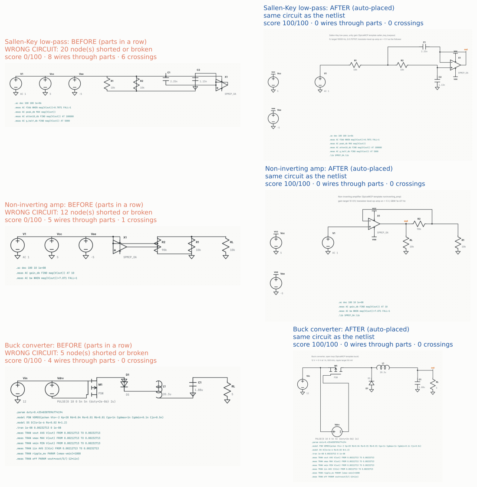
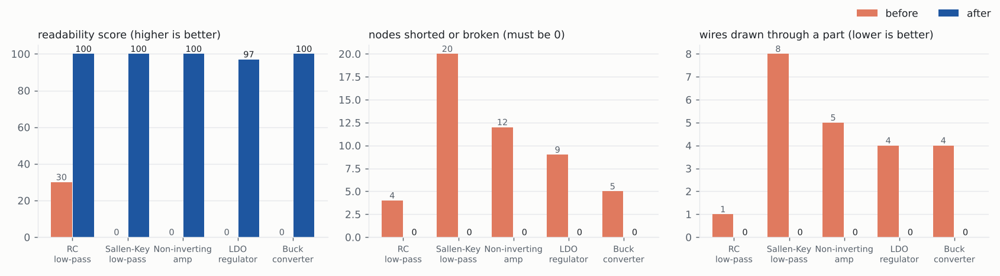
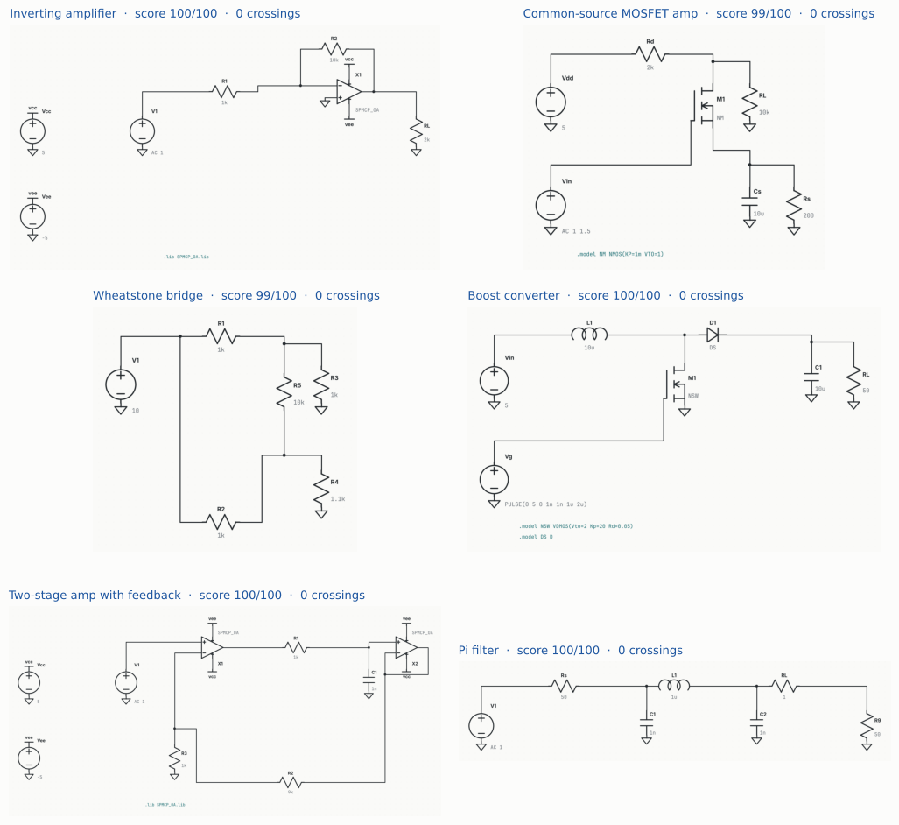

# Step 4: schematics drawn from a netlist

> Re-simulated in step 6: the op-amp circuits now use a transistor-level op-amp and the buck a power MOSFET (see `../step6/REPORT.md`). The numbers below are from that version.

**In one line:** give SpiceMCP a netlist and it now draws the schematic an engineer
would draw, and proves the drawing is the same circuit.

Regenerate everything here with `python docs/reports/step4/make_report.py`.

## What was wrong before

A netlist is a list of "this part connects these nodes". Before this step, turning one
into a schematic meant someone had to pick an (x, y) for every part. Without that,
the best the tool could do was drop the parts in a row and join each node's pins with
right-angle wires.

That is not just ugly. Straight wires run across other parts' pins, and in LTspice a
wire touching a pin connects to it. So **every one of the five template circuits drawn
that way came out as a different circuit**, with nodes shorted together or split apart.
The drawing looked plausible and was wrong.

## What it does now

`layout.draw()` (used by `render_schematic` when you pass a `.cir`/`.net`) places and
wires the circuit the way schematics are drawn by hand:

| rule | how |
|---|---|
| signal flows left to right | nodes are put in columns by distance from the sources, and an amplifier's output is always right of its inputs |
| ground at the bottom | every part with one end on ground hangs down from its node and gets its own ground symbol |
| feedback on its own lane | a part that bridges distant nodes (feedback resistor, Sallen-Key C1) goes above or below the main row |
| transistors upright | a MOSFET amplifier stands with drain above source; a pass device on a supply rail lies in the power path |
| clean wires | right angles only, never through a part, never ending on another net's wire, crossing only when unavoidable; a long detour becomes a pair of net labels |

Then the drawing is **read back the way LTspice would read it** and compared with the
netlist, pin by pin. If it is not the same circuit, it is refused. This check needs no
LTspice installed.

## Before and after

## The numbers, all five templates

| circuit | before: score | before: nodes shorted/broken | after: score | after: nodes shorted/broken |
|---|---:|---:|---:|---:|
| RC low-pass | 30 | 4 | 100 | 0 |
| Sallen-Key low-pass | 0 | 20 | 100 | 0 |
| Non-inverting amp | 0 | 12 | 100 | 0 |
| LDO regulator | 0 | 9 | 97 | 0 |
| Buck converter | 0 | 5 | 100 | 0 |

The readability score starts at 100 and loses points for each wire crossing (12),
wire through a part (20), overlapping part (20), connection hidden in the middle of a
wire (25), dangling wire end (10) and excess corners (1 each). No template has a wire
crossing.

## Circuits it was never tuned on

The placer was written against the five templates. These eight were tried only after,
and are in the test suite so they stay this way:

| circuit | score | crossings |
|---|---:|---:|
| inverting amplifier | 100 | 0 |
| common-source MOSFET amp | 99 | 0 |
| Wheatstone bridge | 99 | 0 |
| boost converter | 100 | 0 |
| two-stage amp with feedback | 100 | 0 |
| pi filter | 100 | 0 |
| 5-stage RC ladder | 100 | 0 |
| LC tank | 100 | 0 |

## Also in this step

- Part values are drawn the way people write them: `15.9n`, `10k`, `1Meg`, not
  `1.5915494309189535e-08`. The `.asc` file keeps the exact number, because a rounded
  value is a different circuit.
- A turned part has its name above and its value below, instead of both on one line.
- `start_from_template` writes the run's schematic, so a run has a drawing from step one.
- A small bundled symbol set (R, C, L, D, sources, controlled sources, switch, MOSFETs,
  op-amp)
  lets this work without LTspice installed. A real LTspice library always wins.

## Limits

- Flat netlists plus 5-pin op-amp subcircuits (added in step 6). Any other subcircuit
  call (`X...`) is refused with a clear message.
- The bundled symbols use LTspice's pin positions as documented for its standard parts.
  On Windows the real LTspice library is used, and `asc.check()` can netlist the file
  through LTspice as a second check.

## Tests

`tests/test_layout.py`: 22 tests. All five templates and all eight unseen circuits must
draw as the same circuit, with no wire through a part, no overlaps and no hidden
connections. Other tests check that a deliberately broken drawing is caught, that
drawings are deterministic, and that unsupported parts are refused with a reason.
Full suite: 260 passed, 41 skipped. The 41 failures are the existing LTspice `.raw`
fixtures, which are not in the repository.
