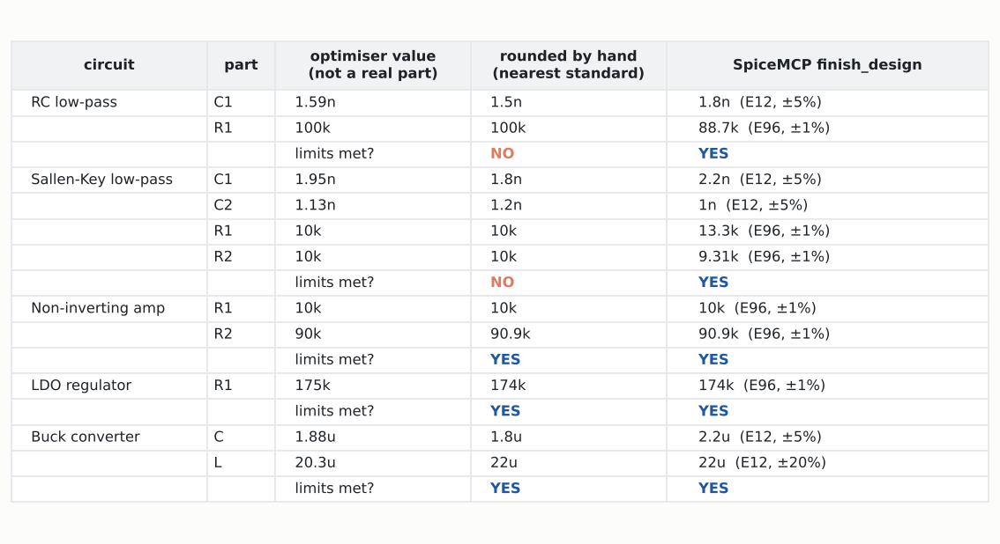
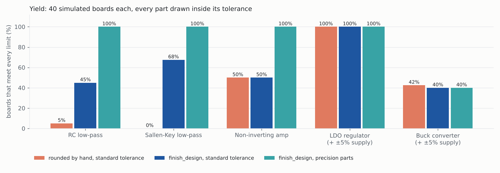
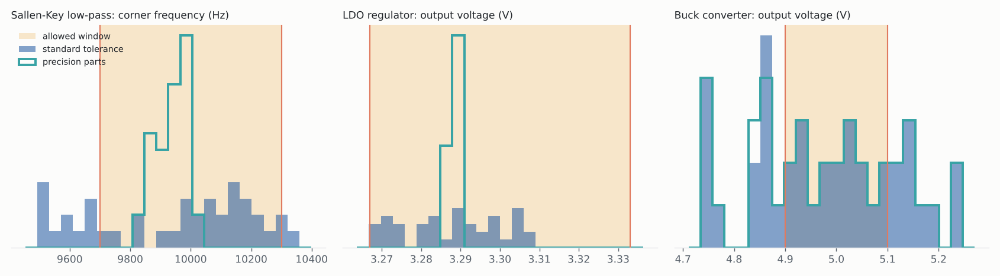

# Step 5: from optimised values to a parts list, with yield

> Re-simulated in step 6: the op-amp circuits now use a transistor-level op-amp and the buck a power MOSFET (see `../step6/REPORT.md`). The numbers below are from that version.

**In one line:** `finish_design` turns the optimiser's best design into standard parts
you can order, and tells you how many built boards will meet the spec.

Regenerate with `python docs/reports/step5/make_report.py`. Every number below is a
real ngspice simulation.

## The problem

The optimiser works with continuous values: its best RC filter has `C1 = 1.5915 nF`.
Nobody sells that. Two things happen on the way to a real board:

1. **Rounding.** Each part moves to a standard value (IEC 60063 E-series), and every
   part moves at once. Rounding one capacitor by 6% moves a filter corner by 6%.
2. **Tolerance.** A 5% capacitor is anywhere within ±5% of its marked value. A design
   that sits exactly on a limit passes on paper and fails on many boards.

Before this step, SpiceMCP stopped at the continuous optimum.

## What `finish_design` does

1. Parts from the coarsest series (usually capacitors, E12) are tried at the standard
   values just below and above the optimised value.
2. For the best two choices, every remaining free value (fine-step resistors, a duty
   cycle, a transistor width) is **re-centred**: moved to maximise the worst margin to
   any limit. This is what an engineer does by hand: pick the capacitors, then recompute
   the resistors.
3. The fine-step parts (E96 resistors) are picked the same way.
4. The best few sets get a **Monte Carlo yield** run: 30 to 40 simulated boards, each
   part drawn at random inside its tolerance, plus the supply inside ±5% where one is
   named. The set with the highest yield wins.

Defaults are what a designer would order: 1% resistors (E96), 5% capacitors (E12) and
20% inductors (E12). Every one can be changed.

## Result 1: rounding by hand breaks two of the five circuits



| circuit | nearest values meet limits? | finish_design meets limits? | worst margin |
|---|:---:|:---:|---:|
| RC low-pass (fc 1 kHz ±2%) | **no** | yes | 1.7% |
| Sallen-Key low-pass (fc 10 kHz ±3%) | **no** | yes | 2.4% |
| Non-inverting amp (gain 20 dB ±0.1 dB) | yes | yes | 0.1% |
| LDO (3.3 V ±1%) | yes | yes | 0.8% |
| Buck (5 V ±2%, ripple ≤ 50 mV) | yes | yes | 1.8% |

For the RC filter, 1.5 nF needs R = 106 kΩ, which is outside the allowed resistor
range. `finish_design` goes to 1.8 nF and re-centres R to 88.7 kΩ. For the Sallen-Key it
picks C1 = 2.2 nF and C2 = 1.0 nF, then re-centres R1 to 13.3 kΩ and R2 to 9.31 kΩ.

## Result 2: yield, and what tolerance is really needed



| circuit | rounded by hand | finish_design | finish_design, precision parts* |
|---|---:|---:|---:|
| RC low-pass | 5% | 45% | 100% |
| Sallen-Key low-pass | 0% | 68% | 100% |
| Non-inverting amp | 50% | 50% | 100% |
| LDO (+ ±5% supply) | 100% | 100% | 100% |
| Buck (+ ±5% supply) | 42% | 40% | 40% |

\* precision parts: 0.1% resistors, 1% capacitors, 10% inductors.
Both designs in each row are judged on the same random boards, so the comparison is
fair. With 40 boards, a yield figure is accurate to about ±8%.

What an engineer should take from this:

- **Filters:** a ±2–3% corner-frequency spec cannot be held with 5% capacitors, whatever
  values you choose. `finish_design` gets the most out of them (5% → 45%, 0% → 68%),
  but the real fix is 1% capacitors, which give 100%.
- **Amplifier:** ±0.1 dB of gain is ±1.2%, and two 1% resistors can be off by 2% in
  ratio. Either use 0.1% resistors or loosen the spec.
- **LDO:** its feedback loop holds the output against ±5% supply and 1% resistors
  (100%).
- **Buck:** this template is open-loop, so its output follows the input. ±5% supply
  gives ±5% output, against a ±2% spec. Precision parts do not help (40%; the 2-point
  differences between columns are within the ±8% resolution). The fix is
  a feedback loop, not better parts. The yield run makes that visible before anything
  is built.

## Where the boards land



The shaded band is the allowed window. Filled bars: standard tolerance. Outline:
precision parts. The LDO stays tight in both cases. The buck spreads the same way in
both, because the supply, not the parts, sets its output.

## Interface

`stop_optimization` is replaced by `finish_design`, which also ends the run. The tool
count stays at 13.

```python
finish_design(run_id="lpf_001")
finish_design(run_id="lpf_001", capacitors="E24", tolerance_pct={"C": 1})
finish_design(run_id="buck_001", supply="Vin", supply_tol_pct=5)
```

The reply carries the parts list (value, series, tolerance, change from the optimised
value), the metrics, the worst margin, the yield, the spread of every limited metric,
and the runner-up sets. The individual Monte Carlo samples are saved to a JSON file.

## Tests

`tests/test_buildable.py` (12 tests) covers:
- the E-series tables and snapping across decades;
- a passing standard-value set for a ±2% RC filter;
- tighter parts raising the yield;
- per-kind series choice;
- clear errors;
- with ngspice: the Sallen-Key nearest values fail and `finish_design` finds a passing
  set.
