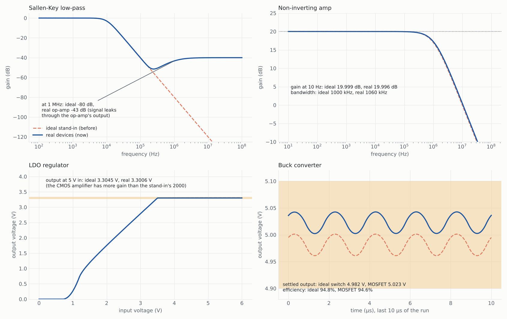
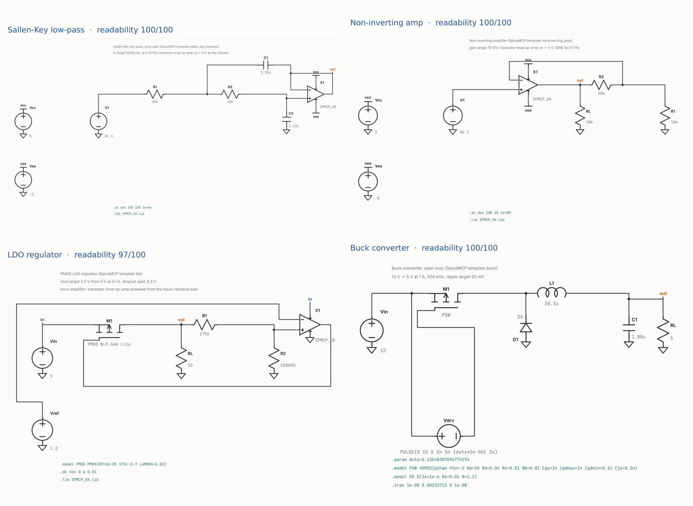

# Step 6: real amplifiers and switches instead of ideal stand-ins

**In one line:** the templates no longer model an op-amp as a dependent voltage source.
They use a transistor-level op-amp built from MOSFETs, and the buck uses a real power
MOSFET as its switch.

Regenerate with `python docs/reports/step6/make_report.py`. Every number below is a
real ngspice simulation.

## Why there was a dependent source

Until now, three templates used ideal parts:

| template | stand-in before | what it is |
|---|---|---|
| Sallen-Key low-pass | `E1 out 0 b out 1e6` | voltage-controlled voltage source, gain 10⁶ |
| Non-inverting amp | two `E` sources + R + C | single-pole op-amp: 100 dB, fixed GBW |
| LDO | `B1 ... V=2000*(V(fb)-V(ref))` | behavioural error amplifier, gain 2000 |
| Buck | `S1 ... SWM` | ideal voltage-controlled switch, 50 mΩ |

A controlled source is the textbook way to get a first answer quickly, and it works on
any simulator without a model file. Its weakness is what it leaves out:

- it has **no supply pins**, so it never clips and draws no current;
- its output has **no limit and no output resistance**, so a load never pulls it down;
- it has **no internal signal path**, so a filter built on it keeps attenuating forever;
- it has **no slew rate, offset or input range**.

A design that only works on the stand-in may not work on a real part. That is not good
enough for sign-off, so it is replaced.

## What replaces it

**Op-amp (Sallen-Key, non-inverting amp, LDO error amplifier).**
`spicemcp/opamp.py` is a two-stage CMOS op-amp made of eight MOSFETs:

- PMOS input pair with a current-mirror load;
- common-source second stage;
- Miller compensation;
- a bias branch.

It runs from its own supply pins (±5 V for the filter and the amplifier, and the input
rail for the LDO). Its gain-bandwidth is set the way an IC designer sets it, through the
compensation capacitor: Cc = gm1 / (2π·GBW).

| measured (ngspice, 10 kΩ load) | GBW asked 1 MHz | GBW asked 10 MHz |
|---|---:|---:|
| open-loop gain | 87.3 dB | 87.5 dB |
| unity-gain frequency | 1.06 MHz | 10.6 MHz |
| slew rate | 1.0 V/µs | 9.9 V/µs |
| supply current | 1.1 mA | 1.1 mA |

It uses the standard 5-pin order (in+ in- V+ V- out, as LTspice's `opamp2` symbol and
most vendor macromodels do). A vendor model with the same pins can be dropped in. The
transistors use SPICE level-1 models, so the same deck runs in LTspice and in ngspice.

**Switch (buck).** The ideal switch becomes a P-channel power MOSFET (`VDMOS`: 50 mΩ
on-resistance, 1 nF gate capacitance), driven 10 V below the input by a gate driver.

## Result 1: what the ideal stand-in was hiding

Same circuits, same part values, ideal stand-in (dashed) versus real devices (solid):

- **Sallen-Key:** up to about 200 kHz both are the same. Above that, the ideal model
  keeps falling at 40 dB/decade, reaching −80 dB at 1 MHz. The real op-amp lets the
  signal leak through C1 into its output, and the response flattens at about −40 dB
  (**−43 dB at 1 MHz**). This is the well-known Sallen-Key stopband leakage. The ideal
  model cannot show it. If the filter must block a 1 MHz clock, only the real model gives
  the right answer.
- **Non-inverting amp:** gain and bandwidth agree within 0.01 dB and 6%. The single-pole
  stand-in was a fair small-signal model. The real op-amp adds what it left out: supply
  current, output swing and slew rate.
- **LDO:** both regulate. The real amplifier has more gain than the stand-in's 2000, so
  the output is closer to target (3.3006 V vs 3.3045 V at 5 V in).
- **Buck:** the MOSFET's gate charge stretches each on-time a little. The output moves
  from 4.98 V to 5.02 V, and the ripple from 40 to 42 mV. The hand calculation now keeps
  20% ripple margin for this.

All five templates still meet their specs at the hand-sized start (test suite).

## Result 2: the schematics show the real parts

- The op-amp is drawn with the standard 5-pin op-amp symbol.
- Its supply pins carry rail labels (`vcc`, `vee`), and the supplies sit at the left.
- Its `.subckt` is written next to the `.asc` as `SPMCP_OA.lib`, so the file opens and
  simulates in LTspice as it is.
- The buck's power MOSFET is drawn as a 3-pin MOSFET.

The test circuits used to check the schematic drawer were also changed: the inverting
amp and the two-stage amp now use the op-amp, and the boost uses an N-channel MOSFET.
All of them still read back as the same circuit as their netlist, with a readability
score of 100.

## Tests

`tests/test_opamp.py` (11 tests) covers:
- no template uses an `E`, `F`, `G`, `H`, `B` or `S` element;
- the compensation follows the requested GBW;
- in ngspice: open-loop gain above 75 dB and unity-gain frequency within 25% of the
  request, at 1 MHz and at 10 MHz;
- the op-amp draws as the 5-pin symbol with its library beside it;
- the power MOSFET draws as a 3-pin part;
- a non-op-amp subcircuit is refused with a reason.

## Limits

- The MOSFETs are level-1 models with no junction capacitances. The op-amp's second pole
  and its phase margin are therefore optimistic. They are good enough for a filter or
  regulator well below GBW, but not for a stability sign-off. For that, use the vendor
  model of the part you will buy.
- The buck is still open-loop. A feedback controller is a separate step.
