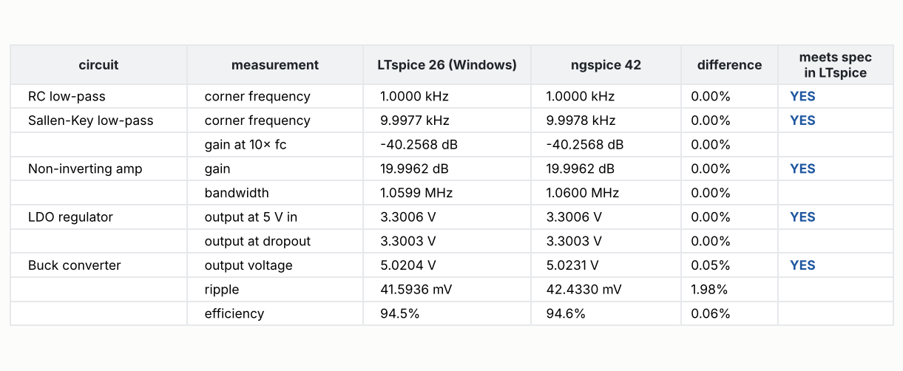

# Step 7: proven in real LTspice on Windows, and tested on every change

**In one line:** everything SpiceMCP draws and simulates was checked in LTspice 26 on
Windows 11, and GitHub now runs the full test suite on Linux and Windows for every change.

Until this step, every result was checked with ngspice only. LTspice is the product's
simulator, so this step closes that gap.

## What was run in LTspice

`tools/ltspice_check.py`, on a Windows 11 laptop with LTspice 26.0.2:

| check | result |
|---|---|
| LTspice reference files for the waveform tests | **10 of 10** generated and committed |
| drawn schematics that LTspice reads back as the same circuit | **13 of 13** |
| ready-made circuits that meet their spec in LTspice | **5 of 5** |
| largest LTspice vs ngspice difference on any spec'd number | **2%** (buck ripple) |

## Schematics: LTspice agrees with the drawing

Each of the 5 templates and the 8 drawing test circuits was drawn by SpiceMCP, saved as
an `.asc`, and netlisted by LTspice itself. LTspice's netlist was compared with the
original netlist, pin by pin. All 13 match.

This also proves the parts added in step 6 work in LTspice as they are:
- the 5-pin op-amp symbol;
- the `SPMCP_OA.lib` written beside the drawing;
- the power MOSFET.

For example, the amplifier comes back from LTspice as
`XX1 N002 N001 vcc vee out SPMCP_OA` with `.lib SPMCP_OA.lib`.

## Simulation: LTspice and ngspice agree

- Filters, amplifier and LDO agree to better than 0.01%.
- The buck differs by 2% in ripple (41.6 vs 42.4 mV). The two simulators use different
  MOSFET switching time steps. Both are well inside the 50 mV limit.
- All five meet every limit in LTspice. Each one simulates in under a second, except the
  buck at 3.5 s.

## Tests on every change (CI)

GitHub Actions runs the whole suite on Ubuntu (with ngspice) and on Windows, under
Python 3.11 and 3.13. The 41 tests that used to fail for want of LTspice reference files
now run everywhere, because the files are committed.

The LTspice run also found one stale test. It called a `simulate_sweep` tool that was
folded into `simulate` in step 1, and because it only runs where LTspice is installed,
it had never run since. It now calls `simulate(sweep_param=..., sweep_values=...)`.

## Release housekeeping

- The version lives in `pyproject.toml` only. The package reads it from there, and a test
  checks that `CHANGELOG.md` has an entry for it.
- Releases are tagged `vX.Y.Z` on main.

## Regenerate

- On Windows with LTspice: `python tools/ltspice_check.py`. This writes `ltspice_check.json`
  and the fixtures.
- Anywhere with ngspice: `python docs/reports/step7/make_report.py`.
