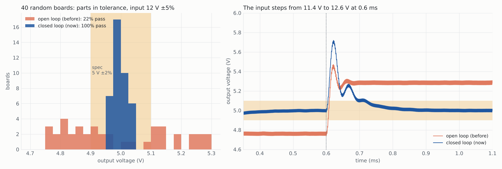
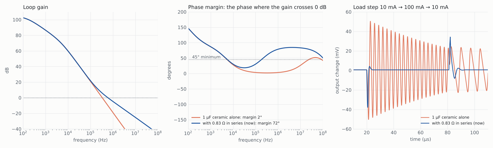
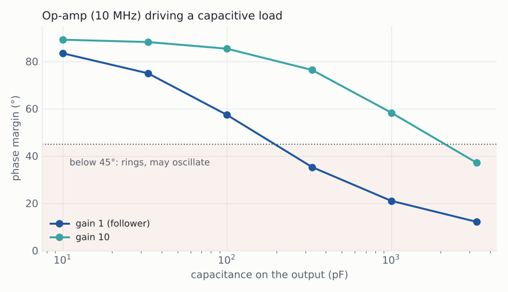

# Step 8: a buck that regulates, and a stability check on every feedback loop

**In one line:** the buck converter now has a feedback controller, so its output holds
5 V on 100% of boards instead of 22%, and every circuit with a feedback loop is checked
for phase margin (and the LDO for load steps) each time it is simulated.

Regenerate with `python docs/reports/step8/make_report.py`. Every number below is an
ngspice simulation of the template decks.

## 1. The buck: from fixed duty cycle to closed loop

Up to 0.12 the buck ran at a fixed duty cycle. Its output followed the input and the
parts: ±5% on the input gave about ±5% on the output, against a ±2% spec. Step 5 showed
that better parts do not help. The fix is a feedback loop.

The template now has a voltage-mode PWM controller, built from transistors like the rest:

- a divider (R1, R2) and a 1.2 V reference;
- an error amplifier wired as an integrator (CI), the same CMOS op-amp as elsewhere;
- a comparator against a 0.5 to 2.5 V ramp at the switching frequency;
- a push-pull output stage (0.1 A driving 5 A) that drives the MOSFET gate.

The loop crosses over a decade below the LC corner (2.2 kHz here), which gives about 90°
of phase margin and 15 dB of gain margin at the LC peak. The output capacitor is now sized
for the worst-case parts (inductor 20% low, capacitor 5% low), not the nominal ones.

| 40 random boards (L ±20%, C ±5%, R ±1%, input 12 V ±5%) | open loop (0.12) | closed loop (now) |
|---|---:|---:|
| meet 5 V ±2% and ripple ≤ 50 mV | **22%** | **100%** |
| output, lowest to highest board | 4.77 to 5.28 V | 4.96 to 5.03 V |
| largest ripple | | 43 mV |

Both columns use the same random draws for the parts they share. The closed-loop spread
that remains (±0.7%) is the 1% divider resistors.

**Input step (right).** At 0.6 ms the input jumps from 11.4 V to 12.6 V in 1 µs. The open
loop settles at 5.28 V, out of spec. The closed loop peaks at 5.72 V and is back inside
±2% after 0.12 ms. That peak is the cost of a slow, simple loop. A faster (type-III)
compensator would shrink it.

**Efficiency** reads 89% instead of 93%. The difference is the gate drive and the
controller, which now draw their real current from the input. The old ideal gate source
charged the gate for free.

## 2. Stability checks, run with every simulation

A feedback circuit can meet every DC and frequency spec and still oscillate. A circuit
now carries one deck per check, one after another in the same netlist. SpiceMCP runs each
deck and merges the measurements, so the optimiser, `finish_design` and its yield run all
see phase margin next to gain and output voltage.

The loop is opened at the amplifier input. A 1 kH inductor keeps the DC bias, so the
circuit sits at its real operating point, and opens the loop at every frequency swept. A
1 kF capacitor injects a 1 V test signal. What comes back is the loop gain. Where it falls
to 1 (0 dB) is the crossover (`ugf`), and the phase there is the phase margin (`pm_deg`).
Every feedback template must keep at least 45°.

### The LDO

Every LDO needs an output capacitor, and the template had none. With a 1 µF ceramic
capacitor alone, the error amplifier's pole and the output pole both sit far below
crossover. The phase margin is **2°** and a load step rings for the whole pulse (orange).
A real board built that way would oscillate.

The classic fix is a zero: a small resistance in series with the capacitor. That is
either the capacitor's own ESR or a resistor. The template sizes it by hand:

- crossover fc = GBW · gm · β · Rz, and the zero fz = 1 / (2π · Rz · Cout);
- put fc = 3 · fz, which gives Rz = √(3 / (2π · Cout · GBW · gm · β)) = **0.83 Ω**.

| LDO, 3.3 V at 0.1 A, 1 µF | ceramic alone | with 0.83 Ω (now) |
|---|---:|---:|
| phase margin | **2°** | **72°** |
| crossover | 334 kHz | 595 kHz |
| dip on a 10 mA → 100 mA step | 51 mV, then rings | 39 mV, settles in 1.5 µs |
| rise when the load drops | 24 mV, then rings | 34 mV |

The 0.83 Ω resistor is now a part in the parts list, and the load step has a limit of 3%
of the output (99 mV) in both directions.

### Op-amp circuits

The op-amp's transistors now have gate and overlap capacitance. Before, they had none,
so every loop read exactly 90°, whatever it drove. Now phase margin falls as the
capacitance on the output rises, as it does on a real part. A unity-gain follower is the
hardest case: it drops below 45° at about 200 pF. The same op-amp at a gain of 10 is fine
up to about 2 nF.

The Sallen-Key and the amplifier take a `cload` spec (100 pF by default). At their
default specs they have 86° and 85°. A spec that asks a fast follower to drive 1 nF now
fails its phase-margin limit, with the advice to lower the op-amp's bandwidth or isolate
the load with a series resistor.

## Interface

No new tools. `list_templates` shows the new spec keys (`cload`, `cout`, `step_pct`), and
the new limits (`pm_deg`, `step_mv`, `kick_mv`) come with the template. Any netlist can
use the same mechanism: write several decks, each ending in `.end`. Measurement names
must be unique across decks. Only the first deck is drawn.

## Tests

`tests/test_stability.py` (11 tests):

- decks split and merge, and a measurement name used in two decks is refused;
- the ngspice translation of a complex `FIND` gives dB and degrees;
- every feedback template carries the 45° limit, and only the circuit deck is drawn;
- with ngspice:
  - phase margin falls with load capacitance;
  - the LDO is unstable without its zero resistor and stable with it;
  - the closed-loop buck holds 5 V within 0.4% at 11.4 V and 12.6 V in.
