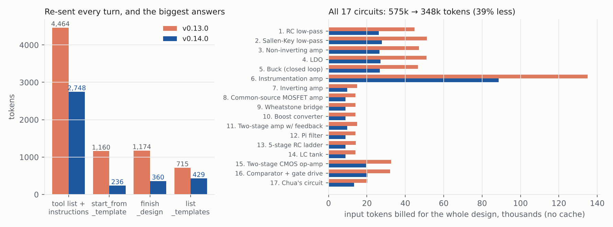
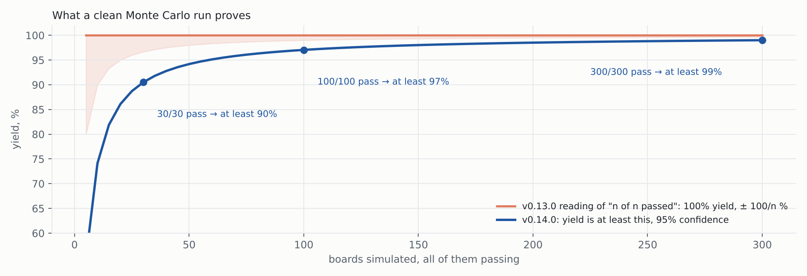

# Step 9: Phase 0 quick fixes (v0.14.0)

**In one line:** the same 17 designs now cost 39% fewer input tokens, the yield answer
states what a Monte Carlo run actually proves, and the code has a license.

Regenerate with `python docs/reports/step9/make_report.py`. Token numbers: the 17 flows
of the v0.13.0 assessment, run end to end over MCP stdio on ngspice with `measure/run.py`,
counted with `measure/analyze.py` (same tokenizer before and after).

## 1. Tokens

| | v0.13.0 | v0.14.0 |
|---|---:|---:|
| Tool list + instructions, re-sent every turn | 4,464 | 2,748 |
| start_from_template answer (average) | 1,160 | 236 |
| finish_design answer (average) | 1,174 | 360 |
| list_templates answer | 715 | 429 |
| All answers, 17 circuits | 37,245 | 19,167 |
| Billed input, 17 circuits, no cache | 575,176 | 348,459 (−39%) |
| Billed input, 17 circuits, with cache | 168,132 | 102,940 (−39%) |

What changed: no JSON-schema `title`s, short field text, `Optional[X] = None` listed as
`X`, `sim_options` / `skip_preflight` / `seed` accepted but not listed; answers are
one-line JSON with 6-digit numbers; long material (hand calculation, full feasibility
report, finish_design alternatives and spread) moved to `query_run(what="details")`.

Still large: borrowing the op-amp model (circuits 15, 16, 6) costs a template run plus a
1,200 to 1,500 token netlist dump. Phase 1 adds the blocks by name.

## 2. Yield

- Before: "30 runs resolve yield to about 3%". Wrong: 30/30 passing only proves yield
  above 90.5% at 95% confidence (one-sided Clopper-Pearson, `0.05 ** (1/30)`).
- Now: `"statement": "30/30 pass: yield is at least 90% (95% confidence)"` plus
  `yield_at_least_pct`. The design report's Monte Carlo note says the same.
- The yield seed was always 0, so a re-run drew the same boards. It is now random per
  call, reported as `seed`, and `seed=` repeats a run.

## 3. Housekeeping

- MIT `LICENSE`, `license` in `pyproject.toml`.
- `docs/final/SpiceMCP_Engineering_Report.pdf` rebuilt (the v0.13.0 copy was two builds
  written over each other); it is now written to a temporary file and moved, and
  `tests/test_docs.py` checks every shipped PDF's cross-reference table.
- The report's readability table adds today's scores (LDO 76, buck 69) next to the
  step 4 ones, computed when the PDF is built.
- No more "impractical value" warnings on the 1 kH / 1 kF loop-break test parts.

Not changed here: the buck flow still takes about 20 minutes on ngspice (19.6 min in this
measurement), almost all of it in finish_design. That is Phase 1.
